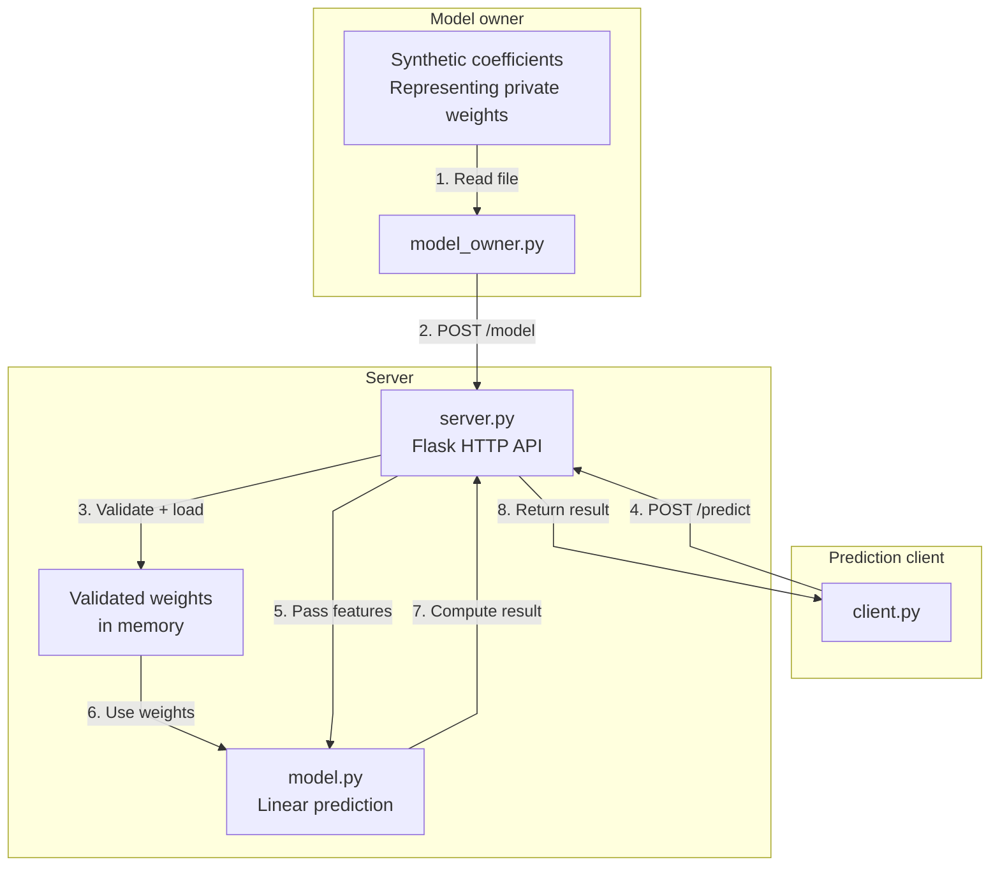
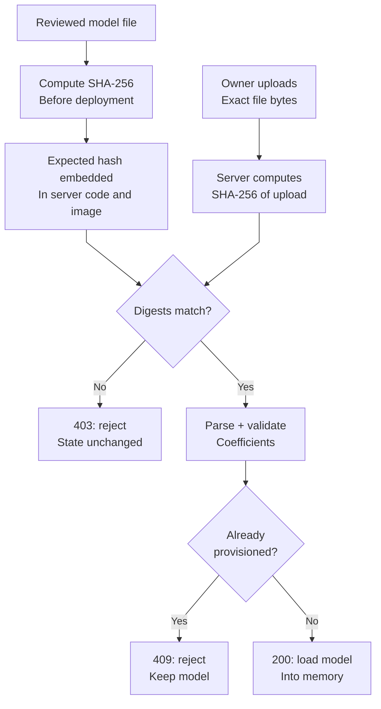
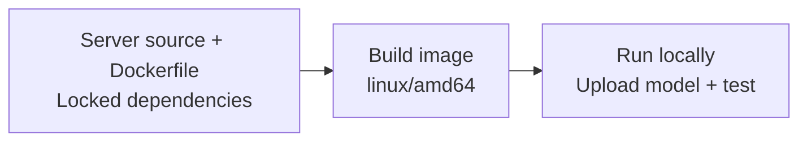

# Build a prediction server: from local Python to local Docker

Start with a small prediction service and make it run in two environments: directly with Python, then inside a local Docker container. The computation and API stay the same; only how we package and start the server changes. No cloud account or image-registry account is needed.

There are three roles: the server, the model owner, and the prediction client. The server starts without weights. The model owner uploads synthetic coefficients representing their private model weights, then the client sends property features and receives a prediction. Both scripts can run on your laptop while representing separate parties. We use plain HTTP here; it does not protect real secrets.

Use two terminals: keep the server running in one and run the owner and client scripts in the other. First run everything directly with Python, then repeat the workflow with the server inside Docker. Later modules add [TLS](../2_TLS_Transport/README.md), [cloud deployment](../3_Deploy_TDX/README.md), and [remote attestation](../4_Remote_Attestation/README.md).

## The application

The server combines the owner's coefficients with the client's three property features: area, bedrooms, and age. The client receives the result, not the coefficient file.

The prediction itself is just:

```python
prediction = model['bias'] + sum(
    features[name] * model['weights'][name] for name in FEATURES
)
```

With the example model, it calculates:

```text
price = 500,000 + 40,000 × area_m2 + 200,000 × bedrooms − 15,000 × age_years
```

The coefficients are synthetic, not trained or suitable for actual valuations. Exact linear-model outputs can also reveal coefficients through repeated queries; confidential execution alone does not prevent that.

### Files and roles

The owner uploads its model with `POST /model`; the client requests a prediction with `POST /predict`. `GET /health` reports whether the server has a model loaded. The files are organized by who runs them:

```text
1_Build_Server_Docker/
  README.md                 Tutorial and commands for all three roles
  server/
    server.py               Flask routes and model-file hash policy
    model.py                Validation and inference
    Dockerfile, .dockerignore, requirements.txt
    test_server.py
    pyproject.toml, uv.lock  Independent uv project
  model_owner/
    model_owner.py          Model upload script
    model.example.json      Weights held by the owner
    pyproject.toml, uv.lock  Independent uv project
  client/
    client.py               Prediction request script
    pyproject.toml, uv.lock  Independent uv project
```

Each role has its own Python project. The server uses **Flask**, a web framework that maps HTTP requests to Python functions. The owner and client use Python's standard library. For now, run all three on your laptop. Only the server will go into the Docker image.

### Request flow



The server checks the uploaded file against a fixed SHA-256 hash before loading its coefficients. This approves the file's contents, not the uploader's identity. We will inspect that check after the first successful prediction. The model lives in memory and disappears when the server restarts.

## Prerequisites

Install [uv](https://docs.astral.sh/uv/getting-started/installation/), which manages Python and the local environment. On macOS with Homebrew, run `brew install uv`. On Linux, the official installer is `curl -LsSf https://astral.sh/uv/install.sh | sh`; reopen your terminal afterward if uv is not on PATH.

On **macOS**, install and launch [Docker Desktop](https://docs.docker.com/desktop/setup/install/mac-install/). Choose the installer for Apple Silicon or Intel as appropriate. Docker is needed only from step 2 onward.

On **Ubuntu**, follow [Docker Engine installation](https://docs.docker.com/engine/install/ubuntu/), including `docker-buildx-plugin`, and ensure `python3` and `curl` are installed. If your account requires `sudo` for Docker, use `sudo docker` in place of `docker` throughout this guide, including build, inspect, run, and stop. On Docker Desktop for Mac, use commands without `sudo`.

In your terminal, check:

```bash
# Confirm uv is installed and print its version.
uv --version
# Confirm curl is installed and print its version.
curl --version
```

**Expected result:** uv and curl print their versions. You can complete step 1 before setting up Docker. uv manages the dependencies; there is no separate manual pip installation step.

## Step 1 — Run locally with uv

Run the commands from `1_Build_Server_Docker/`, which contains the `server/`, `model_owner/`, and `client/` directories. Replace the example path with your local checkout:

```bash
# Enter module 1; keep this as the working directory in both terminals.
cd /path/to/1_Build_Server_Docker
```

Inspect [server/server.py](server/server.py), starting at `create_app()`. It creates the Flask application and its three routes. The model starts as `None`, so `/predict` rejects requests until `/model` accepts an upload. At the bottom, `app.run(...)` starts Flask's local development server.

In **terminal 1**, start the server:

```bash
# Install this role's dependencies from its checked-in lockfile.
uv sync --project server --locked
# Start the local development server; leave this terminal running.
uv run --project server python server/server.py
```

In `uv run --project server python server/server.py`, `--project server` tells uv to use [server/pyproject.toml](server/pyproject.toml) and its locked dependencies. `server/server.py` is the file Python executes. Both paths start from the module directory, so you do not need to enter `server/`. The owner and client commands follow the same pattern with their own projects.

uv installs the server's dependencies in `server/.venv/`, a Python environment kept separate from the other roles. It selects Python 3.12 or later, downloading an interpreter if needed. This local runner uses Flask's development server on both macOS and Linux. **Expected:** the server listens on `http://127.0.0.1:8000`. Leave terminal 1 running. [uv project commands](https://docs.astral.sh/uv/guides/projects/)

### Check the server before uploading a model

Before running the client, inspect [client/client.py](client/client.py). Follow the command-line arguments into the `features` dictionary, then into the JSON `POST /predict` request. The client prints the returned prediction and reports HTTP errors; it never reads the owner's model file.

In **terminal 2**, open the same `1_Build_Server_Docker/` directory and run:

```bash
# Query server health and check whether a model has been provisioned.
curl --fail --show-error http://127.0.0.1:8000/health
# Confirm prediction returns HTTP 503 before model provisioning.
uv run --project client python client/client.py --url http://127.0.0.1:8000
```

The server is alive but health reports `{"status": "ok", "model_ready": false}`. The prediction request fails with HTTP 503 because there is no model yet.

### Upload the model and request predictions

Before uploading, inspect [model_owner/model_owner.py](model_owner/model_owner.py) and [model_owner/model.example.json](model_owner/model.example.json). The file contains a bias and one coefficient per feature. In the uploader, find `read_bytes()` and the `POST /model` request: the original file bytes are sent unchanged because reformatting JSON would change its hash. The default model path is beside the owner script, not in the server directory.

Inspect `validate_model()` and `predict()` in [server/model.py](server/model.py) as well. Trace how the uploaded coefficients combine with the client's features to produce the result. This computation is separate from HTTP handling, so it can remain unchanged when secure transport is added later.

Act as the model owner, then make client predictions:

```bash
# Upload the approved model file to the selected server.
uv run --project model_owner python model_owner/model_owner.py \
  --url http://127.0.0.1:8000 --model model_owner/model.example.json
# Query server health and check whether a model has been provisioned.
curl --fail --show-error http://127.0.0.1:8000/health
# Send features and print the returned prediction.
uv run --project client python client/client.py --url http://127.0.0.1:8000 \
  --area-m2 120 --bedrooms 3 --age-years 10
# Send features and print the returned prediction.
uv run --project client python client/client.py --url http://127.0.0.1:8000 \
  --area-m2 100 --bedrooms 2 --age-years 20
# Send an invalid negative feature and expect HTTP 400.
uv run --project client python client/client.py --url http://127.0.0.1:8000 --area-m2 -1
```

**Expected result:** the owner prints `Model provisioned successfully.`; health now reports `{"status": "ok", "model_ready": true}`; predictions are `5750000.0` and `4600000.0`; the negative input reports HTTP 400 and exits unsuccessfully. The client sends no model file and does not check a model hash or commitment.

### Inspect the model-file check

Return to `POST /model` in [server/server.py](server/server.py). The server hashes the original uploaded bytes and compares the result with `EXPECTED_MODEL_SHA256` before parsing the file. The uploader cannot supply its own expected hash.



The included file already matches the embedded hash:

```text
653bfcb49975bb472c52ec031a75dc3df51acdc34496d979cdfa66a8f18e4701
```

Run the owner command again against the same server. It returns **HTTP 409** because the approved model is already loaded. To see the hash check reject a file, save a copy as `model_owner/model.changed.json` and change one coefficient or its whitespace. Then run:

```bash
# Upload the changed copy; expect HTTP 403 and no change to the loaded model.
uv run --project model_owner python model_owner/model_owner.py \
  --url http://127.0.0.1:8000 --model model_owner/model.changed.json
```

A hash commits to exact bytes, including formatting and a final newline. To approve another model, review its file, update the embedded hash, and rebuild the application. The client does not check the weights separately. Anyone holding the approved file can upload it; this is a content restriction, not owner authentication. The hash does not encrypt the file and can expose guessable coefficients to offline guessing.

Stop the server with **Ctrl-C in the first terminal** before proceeding. The local server binds only to localhost. Docker will set `HOST=0.0.0.0` inside the container so its port forwarding works.

## Step 2 — Package the server with Docker

A Docker **image** packages the server code, Python interpreter, dependencies, and startup command. A **container** runs that image. Building and starting it are separate steps:



The owner and client stay outside the image, and the model file stays with the owner until upload. Start Docker Desktop or Docker Engine, then check:

```bash
# Check that both the Docker client and engine are available.
docker version
# Confirm Docker Buildx is installed.
docker buildx version
```

Docker should report both Client and Server versions, and Buildx should print its version. A Docker client version alone does not mean the engine is running.

### Build the image

Inside the container, **Gunicorn** runs the Flask application and handles incoming HTTP connections. This replaces the local development server without changing the Flask routes or prediction code.

Before building, inspect [server/Dockerfile](server/Dockerfile) alongside [server/.dockerignore](server/.dockerignore). Read the Dockerfile from top to bottom:

- `FROM` selects the Python runtime by digest; it is not the application image you are building.
- `WORKDIR /app` selects the working directory inside the image.
- `COPY requirements.txt` and `RUN ... --require-hashes` install the locked server dependencies.
- `COPY server.py model.py` adds only the server implementation, not the client, uploader, or model weights.
- `ENV` and `EXPOSE` describe the runtime settings and container port; host access still requires the `-p` mapping shown below.
- `CMD` starts Gunicorn with `server:app`, importing the Flask `app` object from `server.py`. One worker keeps the uploaded model in a single process.

The `.dockerignore` allowlist filters what Docker can copy from the `server/` build context. Compare it with the Dockerfile's `COPY` instructions to see exactly which files enter the image.

Export the checked-in uv lock to the hashed requirements consumed by Docker:

```bash
# Export locked dependencies and distribution hashes for the Docker build.
uv export --project server --frozen --no-dev --no-emit-project --format requirements-txt \
  --output-file server/requirements.txt
```

Inspect the generated [server/requirements.txt](server/requirements.txt): each dependency has a pinned version and allowed distribution hashes. Keep it in Git alongside `server/uv.lock`. Docker installs it with `pip --require-hashes`, so the package versions and downloaded distributions are pinned. After changing dependencies with uv, regenerate this file before building.

```bash
# Build the linux/amd64 server image and load it into local Docker.
docker buildx build --platform linux/amd64 --load \
  --tag sec304-house-price:stage1 ./server
```

`--load` stores the built image in local Docker. `./server` selects the build context: the directory Docker can copy from. The [.dockerignore](server/.dockerignore) allowlist limits those inputs to the server and its build files. The image includes neither the model file nor either caller.

We use `linux/amd64` because the later Intel TDX guest runs that architecture. Keep this option on Apple Silicon; Docker Desktop can run the Intel image through emulation. [Docker platform builds](https://docs.docker.com/build/building/multi-platform/)

Inspect the result:

```bash
# Inspect the local image architecture and startup command.
docker image inspect sec304-house-price:stage1 \
  --format 'Architecture={{.Architecture}} Command={{json .Config.Cmd}}'
```

**Expected result:** the architecture is `amd64`, and the command starts `gunicorn` with `--workers 1`, `--threads 4`, and `server:app`.

Use exactly **one worker**: the uploaded model lives in one process's memory. Four threads share that model through the application lock; multiple worker processes would have separate model states. The container uses Gunicorn rather than Flask's development server. [Flask deployment guidance](https://flask.palletsprojects.com/en/stable/deploying/gunicorn/)

### Run and test the container

Unlike `python server.py`, the container's startup command uses Gunicorn to import the existing Flask app as `server:app`. The API and prediction code are unchanged.

In **terminal 1**, run:

```bash
# Start the local server container with the shown port mapping.
docker run --rm --name sec304-house-price-local --platform linux/amd64 \
  -p 127.0.0.1:18000:8000 sec304-house-price:stage1
```

The server runs in the foreground. Leave that terminal open. The mapping connects port 18000 on your computer to port 8000 in the container; the host endpoint is restricted to localhost.

In **terminal 2**, still in the module directory, repeat the same owner/client workflow. This time use port **18000**, which Docker forwards to the container:

```bash
# Query server health and check whether a model has been provisioned.
curl --fail --show-error http://127.0.0.1:18000/health
# Confirm this fresh container also returns HTTP 503 before provisioning.
uv run --project client python client/client.py --url http://127.0.0.1:18000
# Upload the approved model file to the selected server.
uv run --project model_owner python model_owner/model_owner.py \
  --url http://127.0.0.1:18000 --model model_owner/model.example.json
# Query server health and check whether a model has been provisioned.
curl --fail --show-error http://127.0.0.1:18000/health
# Send features and print the returned prediction.
uv run --project client python client/client.py --url http://127.0.0.1:18000 \
  --area-m2 120 --bedrooms 3 --age-years 10
```

The first health response has `model_ready: false`, and the first prediction fails with HTTP 503. After the owner uploads, health and prediction return:

```text
{"status": "ok", "model_ready": true}
{"prediction_baht": 5750000.0}
```

The prediction matches the same calculation you ran without Docker. Try a second input and confirm the result changes:

```bash
# Send features and print the returned prediction.
uv run --project client python client/client.py --url http://127.0.0.1:18000 \
  --area-m2 100 --bedrooms 2 --age-years 20
```

**Expected result:** the second prediction is `4600000.0` baht. You have tested the complete host-client → container-server → prediction path.

Test rejection as well:

```bash
# Send an invalid negative feature and expect HTTP 400.
uv run --project client python client/client.py --url http://127.0.0.1:18000 --area-m2 -1
```

**Expected result:** the client reports HTTP 400 and exits with a nonzero status. Negative values are rejected, not used to calculate a prediction.

Stop the local test container from the second terminal:

```bash
# Stop only this tutorial's named container; --rm removes it afterward.
docker stop sec304-house-price-local
```

Its `--rm` setting removes the stopped container. Your source files and local image remain.

## Optional — Run the application tests

Inspect [server/test_server.py](server/test_server.py) before running it. Each test creates a Flask test client and sends requests directly to the app without opening a network port. Follow the assertions for startup, accepted/rejected uploads, prediction errors, and state reset. Its synthetic model fixture makes the server's tests independent of the owner's directory.

You can check the model-file policy and API without starting a server:

```bash
# Run the local regression tests without deploying cloud resources.
uv run --project server python -m unittest discover -s server -v
```

The tests cover startup without weights, exact-file approval, tampered/reformatted uploads, duplicate provisioning, invalid inputs, oversized requests, and state reset in a new application instance.

## Optional — Run the roles on separate computers

The main tutorial runs all roles on one laptop. To separate them, copy only the relevant role directory to each computer; the owner also needs its model file. Each directory has its own `pyproject.toml` and `uv.lock`.

Inside a copied role directory, omit the module-root prefixes. For example, inside `client/`, run:

```bash
# Install this client's own locked environment.
uv sync --locked
# Send features to the server's reachable address, not this client's localhost.
uv run python client.py --url http://SERVER_ADDRESS:8000
```

For a trusted local-network demonstration, start the server from inside its `server/` directory with `HOST=0.0.0.0 uv run python server.py`, and permit port 8000 only from the test computers. The owner uses `uv run python model_owner.py --url http://SERVER_ADDRESS:8000` from its own directory. Use synthetic data and do not expose Flask's development server to the public Internet.

`127.0.0.1` always refers to the computer running the command. Docker's localhost-only port mapping above deliberately blocks remote access; leave it unchanged for the main tutorial.

## Troubleshooting

| Problem                         | Action                                                                                                                                                                           |
| ------------------------------- | -------------------------------------------------------------------------------------------------------------------------------------------------------------------------------- |
| Cannot connect to Docker engine | Start Docker Desktop or the Linux service; apply the Ubuntu `sudo` convention consistently.                                                                                      |
| Port 18000 is busy              | Stop your earlier container or choose another host port and pass the matching URL to `client/client.py --url http://127.0.0.1:NEW_PORT`.                                         |
| `COPY` cannot find source       | Build from this directory and keep the supplied `.dockerignore` file.                                                                                                            |
| Container name already exists   | Inspect `docker ps -a` and stop your earlier named tutorial container.                                                                                                           |
| Changed source has no effect    | Rebuild the local image and restart the container; existing containers do not change automatically.                                                                              |
| Prediction returns HTTP 503     | Run `model_owner/model_owner.py` against this server URL first; restarting clears the model.                                                                                     |
| Owner upload returns HTTP 409   | Weights are already provisioned. Restart your tutorial server before changing them.                                                                                              |
| Owner upload returns HTTP 403   | The file's exact bytes do not match `EXPECTED_MODEL_SHA256`. Check formatting and content; approving a new model requires a reviewed code/image update, not changing the upload. |

## Continue to TLS

You now have the same prediction service running directly with Python and inside Docker. The model owner provisions the weights after each server restart, and the client receives predictions without receiving the model file.

This module establishes application behavior and packaging. Plain HTTP does not protect the requests, and Docker does not isolate the server's memory from its host. Next, [module 2](../2_TLS_Transport/README.md) adds TLS while preserving the application. Keep these role projects and build inputs; Docker Hub publication and Google Cloud deployment come in module 3.
