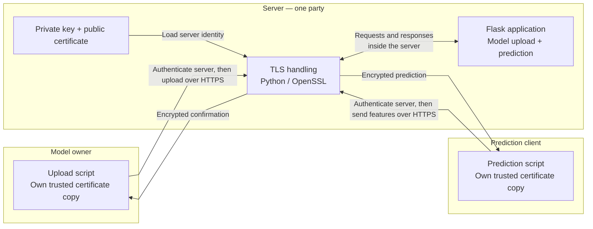

# Add HTTPS without rewriting the application

In [module 1](../1_Build_Server_Docker/README.md), the model owner uploaded coefficients and the client requested predictions over plain HTTP. This module protects those requests with **TLS**. Each caller authenticates the server before sending data, and TLS encrypts the communication.

The Flask routes, prediction calculation, and model-file hash check stay unchanged. We add small TLS entry points around the existing code. As before, run the server directly with Python first, then inside local Docker. No Docker Hub publication, cloud account, or confidential VM is required.

Use two terminals: keep the server running in one and run the owner and client in the other.

## How we use TLS

There are **three parties**: the server, the model owner, and the prediction client. Flask is part of the server, not another party. The server's TLS library handles the secure connection, and Flask handles the requests received over it.

On the **server side**, we generate two files before starting the application:

- **Private key:** stays with the server and lets it prove its identity during TLS.
- **Certificate:** contains the matching public key. The server presents it during TLS.

On the **model owner's and client's sides**, each caller keeps its own trusted copy of that public certificate. Neither receives the private key. When connecting, each checks the server's certificate against its trusted copy, its validity dates, and the requested hostname. Comparing the exact certificate is called **certificate pinning**. Only after authentication does the caller send its model file or features.



The boxes show party boundaries, even though we run all three roles on one laptop here. The TLS-to-Flask arrow represents handling within the server process, not a connection to a fourth party. In the Docker step, TLS handling and Flask run together in the server container; its private key is supplied through a runtime file mount.

TLS connects this identity check to authenticated key exchange. In TLS 1.3, the server uses its private key to sign the handshake, including the key-exchange messages. The caller verifies that signature with the certificate's public key. TLS establishes encryption keys for the connection; the private key never goes to the caller. Python/OpenSSL handle these steps for us. [TLS handshake authentication](https://www.rfc-editor.org/rfc/rfc8446.html#section-4.4.3)

We use a **self-signed certificate** and distribute the trusted copies ourselves. This makes the trust setup visible, but differs from ordinary public websites, which usually use a certificate authority such as [Let's Encrypt](https://letsencrypt.org/getting-started/). Do not obtain a caller's trusted copy from an unverified server connection.

At this stage, TLS proves that the server holds the expected private key and protects communication. It does not prove which code the server runs. Remote attestation comes later.

## Prerequisites

Keep the [uv](https://docs.astral.sh/uv/getting-started/installation/) and [Docker](https://docs.docker.com/get-started/get-docker/) setup from module 1. You also need **OpenSSL 3 or newer** and Docker Compose.

On **macOS only**, select Homebrew's OpenSSL in the terminal used for identity generation:

```bash
# Install OpenSSL 3 for the certificate-generation commands below.
brew install openssl@3
# Select Homebrew's executable rather than the older macOS system utility.
export PATH="$(brew --prefix openssl@3)/bin:$PATH"
# Clear cached command locations after changing PATH.
hash -r
```

On **Ubuntu**, install the `openssl` package and Docker's Compose plugin if needed. On either platform, check:

```bash
# Confirm uv is available.
uv --version
# Confirm this reports OpenSSL 3 or newer; the commands use -noenc and -addext.
openssl version
# Confirm the Docker Compose plugin is installed.
docker compose version
```

Use the same Docker permission convention as module 1: if your Linux setup requires `sudo docker`, apply it consistently to the Docker commands below.

## Step 1 — Generate the TLS identity

Run the commands from `2_TLS_Transport/`, which contains the three role directories and `compose.yaml`:

```bash
# Enter module 2; keep this as the working directory in both terminals.
cd /path/to/2_TLS_Transport
# Choose a persistent local directory for this module's identity.
TLS_KEY_DIR="$(pwd)/keys"
# Create the directory and restrict it to your account.
mkdir -p "$TLS_KEY_DIR"
chmod 700 "$TLS_KEY_DIR"
```

The `keys/` folder is inside this module and outside the `server/` Docker build context. It persists after you close the terminal. Keep private keys in access-controlled storage; never publish them or include them in the image.

Generate a private key and matching certificate. The guard below stops rather than overwriting an existing identity. If you already completed this step, reuse the existing matching pair.

```bash
# Use a subshell so strict error handling does not change your terminal.
(
  # Stop this script on errors instead of continuing with incomplete setup.
  set -eu
  # Refuse to overwrite an existing TLS identity.
  if [ -e "$TLS_KEY_DIR/server.key" ] || [ -e "$TLS_KEY_DIR/server.crt" ]; then
    # Explain why identity generation stopped.
    printf '%s\n' 'Identity files already exist; reuse them or rotate deliberately.' >&2
    # Abort without replacing the existing identity.
    exit 1
  fi
  # Restrict permissions on newly created secret files.
  umask 077
  # Generate the private key and matching self-signed public certificate.
  openssl req -x509 -newkey rsa:3072 -sha256 -noenc -days 30 \
  -subj '/CN=localhost' \
  -addext 'subjectAltName=DNS:localhost,IP:127.0.0.1' \
  -addext 'basicConstraints=critical,CA:FALSE' \
  -addext 'keyUsage=critical,digitalSignature,keyEncipherment' \
  -addext 'extendedKeyUsage=serverAuth' \
  -keyout "$TLS_KEY_DIR/server.key" \
  -out "$TLS_KEY_DIR/server.crt"
  # Restrict the private-key file to its owner.
  chmod 600 "$TLS_KEY_DIR/server.key"
)
```

The main options are:

- `-newkey rsa:3072` generates the RSA key pair. `-x509` creates a self-signed certificate containing its public key.
- `-days 30` sets the certificate's lifetime. `-sha256` selects its signature digest.
- `subjectAltName` allows callers to verify `localhost` and `127.0.0.1`. It does not cover another computer's IP address.
- `CA:FALSE` and `serverAuth` describe a server endpoint certificate, not a certificate authority.
- `-noenc` leaves the key file without a passphrase so the server can start unattended. File permissions restrict access.
- `-keyout` and `-out` keep the private key and public certificate in separate files. [OpenSSL command reference](https://docs.openssl.org/3.0/man1/openssl-req/)

### Give each role its public certificate

Only after generation succeeds, copy the **public certificate** into each role. The server uses it with the private key; the owner and client use it as their trusted reference.

```bash
# Give the server the public half of its TLS identity.
cp -i "$TLS_KEY_DIR/server.crt" server/server.crt
# Give the client its trusted public certificate.
cp -i "$TLS_KEY_DIR/server.crt" client/server.crt
# Give the model owner the same trusted public certificate.
cp -i "$TLS_KEY_DIR/server.crt" model_owner/server.crt
# Record the private-key path for the server and later for Docker Compose.
export TLS_PRIVATE_KEY_FILE="$TLS_KEY_DIR/server.key"
# Inspect the public certificate's subject, validity dates, and allowed names.
openssl x509 -in server/server.crt -noout -subject -dates -ext subjectAltName
```

**Expected:** `keys/` contains `server.key` and `server.crt`, and the three role directories contain identical public `server.crt` copies. The certificate covers localhost and is valid for 30 days. No private key goes into a caller directory or the server image.

`cp -i` prompts before replacing an existing file. If prompted, confirm that you intend to distribute this identity; do not leave the roles using unrelated certificates. A fresh checkout contains no generated keys or certificates.

The `TLS_PRIVATE_KEY_FILE` variable holds a **path**, not key bytes. If you open a new terminal, restore it from the module directory without generating a new key:

```bash
# Locate the existing private key; closing a terminal does not remove it.
export TLS_PRIVATE_KEY_FILE="$(pwd)/keys/server.key"
# Confirm the matching identity files exist and are nonempty.
test -s "$TLS_PRIVATE_KEY_FILE" && test -s keys/server.crt
```

If either file is missing, stop and locate the matching pair. Do not generate another key while retaining the old certificate.

## Step 2 — Run HTTPS locally with uv

### Start the server

Inspect [server/server_tls.py](server/server_tls.py) alongside [server/server.py](server/server.py). The TLS entry point imports the existing Flask `app`, loads `server.crt` and your private key into an `SSLContext`, then starts Flask with HTTPS. A missing or mismatched key prevents startup.

In **terminal 1**, run:

```bash
# Install the server's locked dependencies.
uv sync --project server --locked
# Start the HTTPS development server with the existing private key.
uv run --project server python server/server_tls.py --key "$TLS_PRIVATE_KEY_FILE"
```

As in module 1, `--project server` selects the server's own uv project; `server/server_tls.py` is the Python file to execute from the module directory. The owner and client use their own projects and need no additional TLS packages.

**Expected:** the server listens on `https://localhost:8443`. Leave terminal 1 running. Use `server_tls.py` here, not the preserved HTTP entry point `server.py`.

### Check authentication before uploading the model

In **terminal 2**, open the same module directory. Inspect [client/client_tls.py](client/client_tls.py): it reuses the original client but replaces its `urlopen` function with [tls_transport.py](client/tls_transport.py).

Follow the adapter's `connect()` call, certificate checks, and then `connection.request(...)`. Python/OpenSSL check the certificate and hostname during TLS. The adapter checks the exact certificate before sending HTTP headers or payloads. It rejects plain HTTP and redirects rather than silently sending data elsewhere.

```bash
# Check HTTPS health using the explicitly trusted public certificate.
curl --fail --show-error --cacert client/server.crt https://localhost:8443/health
# Authenticate the server, then expect HTTP 503 because no model is loaded.
uv run --project client python client/client_tls.py --url https://localhost:8443
```

Health reports `model_ready: false`. The prediction receives HTTP 503 **after TLS authentication succeeds**. An application error does not mean the certificate failed verification. curl checks the supplied trust certificate and hostname; our Python adapter also performs the exact-certificate pin check.

### Upload the model and request a prediction

Inspect [model_owner/model_owner_tls.py](model_owner/model_owner_tls.py). It adds the same transport to the original uploader without changing how model bytes are read or sent. Each role has its own copy of `tls_transport.py` so it can run independently.

```bash
# Authenticate the server before uploading the approved model file.
uv run --project model_owner python model_owner/model_owner_tls.py \
  --url https://localhost:8443
# Authenticate the server before sending features and printing the prediction.
uv run --project client python client/client_tls.py --url https://localhost:8443 \
  --area-m2 120 --bedrooms 3 --age-years 10
```

**Expected:** the owner prints `Model provisioned successfully.` and the client receives `prediction_baht: 5750000.0`. The original model-file hash check still applies. Changed files receive HTTP 403, and another upload of the approved file receives HTTP 409.

The new TLS entry points are small additions around the existing application:

| Role              | Existing application                         | TLS entry point                                      |
| ----------------- | -------------------------------------------- | ---------------------------------------------------- |
| Server            | [server.py](server/server.py)                | [server_tls.py](server/server_tls.py)                |
| Prediction client | [client.py](client/client.py)                | [client_tls.py](client/client_tls.py)                |
| Model owner       | [model_owner.py](model_owner/model_owner.py) | [model_owner_tls.py](model_owner/model_owner_tls.py) |

The original files remain available for comparison. Run the TLS entry points in this module; the old scripts do not automatically gain the new certificate checks.

### Observe a rejected connection

A plain-HTTP URL must fail before the client sends any request:

```bash
# Deliberately use HTTP; expect rejection because the TLS adapter requires HTTPS.
uv run --project client python client/client_tls.py --url http://localhost:8443
```

Do not bypass certificate or hostname errors to make a request work. Check the certificate's dates, SANs, and trusted copies instead.

Stop the server with **Ctrl-C in terminal 1** before moving on. As in module 1, the uploaded model disappears when the process stops.

## Step 3 — Run HTTPS inside Docker

### Inspect the Docker changes

Compare [server/Dockerfile](server/Dockerfile) with [module 1's Dockerfile](../1_Build_Server_Docker/server/Dockerfile). The application, base image, and dependencies stay the same. The TLS recipe adds the public certificate and Gunicorn configuration:

```dockerfile
# Include public TLS material and server configuration, never the private key.
COPY server.crt gunicorn_tls.py /app/
# Load the unchanged Flask app using the HTTPS configuration.
CMD ["gunicorn", "--config", "gunicorn_tls.py", "server:app"]
```

Inspect [server/gunicorn_tls.py](server/gunicorn_tls.py). Gunicorn reads the public certificate from the image and the private key from `/run/secrets/tls_private_key`. It uses one worker and four threads, as in module 1, and requires TLS 1.2 or newer.

Then inspect [compose.yaml](compose.yaml). **Docker Compose** lets us describe the image build, ports, and runtime secret in one YAML file:

- `build.context: ./server` uses this module's updated Dockerfile and [.dockerignore](server/.dockerignore).
- `platform: linux/amd64` keeps the server compatible with the later Intel TDX deployment.
- `127.0.0.1:18043:8000` maps your computer's localhost port 18043 to the container's HTTPS port 8000.
- `secrets` supplies the file named by `TLS_PRIVATE_KEY_FILE` at `/run/secrets/tls_private_key`.

The private key stays outside the image. **Local Compose secrets are runtime file mounts**, not an encrypted vault: the Docker host and its administrators can still access the key. The mount prevents baking the key into image layers; Docker is not a TEE. [Compose secrets](https://docs.docker.com/compose/how-tos/use-secrets/)

### Start the container

In **terminal 1**, check that `TLS_PRIVATE_KEY_FILE` still points to `keys/server.key`. Restore it using the command in step 1 if needed, then run:

```bash
# Validate Compose configuration, including the required private-key path.
docker compose config --quiet
# Build the updated image and start the HTTPS container in the foreground.
docker compose up --build
```

Leave this terminal running. The generated public `server/server.crt` must exist before the build; the private key is supplied only when the container starts.

### Repeat the owner/client workflow

In **terminal 2**, still in the module directory, use port **18043**:

```bash
# Check HTTPS health through Docker's localhost port mapping.
curl --fail --show-error --cacert client/server.crt https://localhost:18043/health
# Confirm this new server authenticates but returns HTTP 503 before provisioning.
uv run --project client python client/client_tls.py --url https://localhost:18043
# Authenticate the server, then provision the approved model.
uv run --project model_owner python model_owner/model_owner_tls.py \
  --url https://localhost:18043
# Authenticate the server, send features, and print the prediction.
uv run --project client python client/client_tls.py --url https://localhost:18043 \
  --area-m2 120 --bedrooms 3 --age-years 10
```

**Expected:** health initially reports no model, the first prediction returns HTTP 503, the owner provisions the model, and the final prediction is `5750000.0` baht. The server image contains the application and public certificate. Its private key arrives through the runtime mount, while weights arrive through the owner's HTTPS upload.

The service remains bound to localhost on your computer. No public firewall port is needed.

Stop the foreground container with **Ctrl-C in terminal 1**, then remove its container and network:

```bash
# Remove this module's local containers and network; retain the image and identity.
docker compose down
```

Keep the local image, matching key, and public certificate copies for module 3. Nothing has been published or deployed to Google Cloud yet.

## Optional — Run the regression tests

Inspect [server/test_server.py](server/test_server.py) for the unchanged model/API checks and [tests/test_tls.py](tests/test_tls.py) for the TLS checks:

```bash
# Test model provisioning and prediction without starting a network server.
uv run --project server python -m unittest discover -s server -v
# Test both caller transports using temporary identities and localhost TLS servers.
uv run --project server python -m unittest discover -s tests -v
```

The TLS tests cover accepted connections, wrong trust certificates, wrong hostnames, plain-HTTP rejection, and blocked redirects. They generate temporary test identities without changing your `keys/` directory or application certificates.

## Troubleshooting

| Symptom                                        | What to inspect                                                                                      |
| ---------------------------------------------- | ---------------------------------------------------------------------------------------------------- |
| OpenSSL rejects `-noenc`                       | Select OpenSSL 3 or newer; on macOS, repeat the Homebrew PATH setup above.                           |
| Certificate file missing                       | Generate the identity and copy the public certificate to all three roles in step 1.                  |
| Key does not match certificate                 | Use the matching `keys/server.key`; do not generate a replacement key alone.                         |
| Certificate or hostname verification fails     | Check validity dates, the trusted copy, and SANs. This identity covers localhost and 127.0.0.1 only. |
| Compose reports missing `TLS_PRIVATE_KEY_FILE` | Export the existing absolute key path in the terminal running Compose.                               |
| Docker cannot mount the key                    | Check that the file exists and Docker Desktop can access its directory.                              |
| HTTPS returns HTTP 503                         | Provision the model using `model_owner_tls.py`. Restarting clears the weights.                       |
| Port 18043 is busy                             | Stop an earlier tutorial container, or update the port mapping and caller URLs together.             |

Renewing or replacing the certificate requires deliberately updating all three public copies. If rotating the key too, keep the new pair matched, then rebuild and restart the server. Neither caller should accept a changed certificate merely because a connection failed. For separate caller computers, distribute only their role project and the same trusted public certificate; never send either caller the private key.

## Continue to Intel TDX

You now have the same prediction service running over HTTPS, both directly with Python and inside Docker. Each caller authenticates the expected certificate before sending its input, and TLS protects traffic in transit.

The operator still holds the private key and controls the server. In [module 3](../3_Deploy_TDX/README.md), publish this TLS image and deploy it unchanged inside a TDX VM. Keep this module's matching identity for that intermediate step. [Module 4](../4_Remote_Attestation/README.md) will replace it with a fresh guest-generated key and attestation-based authentication before either caller releases data.
