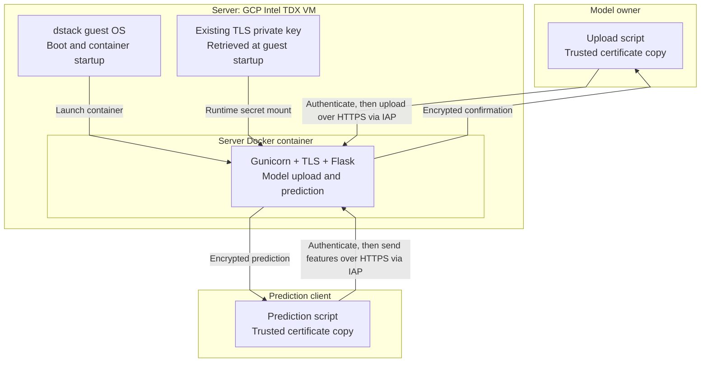

# Deploy the existing HTTPS server to an Intel TDX VM

In [module 2](../2_TLS_Transport/README.md), you ran the prediction server over HTTPS on your computer. Now deploy that **same server image** inside a Google Cloud Intel TDX virtual machine. The application, TLS identity, and caller scripts stay unchanged.

The workflow is to publish the image to Docker Hub, configure the cloud deployment, and repeat the model-upload and prediction requests remotely. The commands use `dstack-cloud` directly so you can inspect each deployment step.

**This module teaches deployment, not caller-side remote attestation.** The callers still trust the operator and the certificate distributed in module 2. [Module 4](../4_Remote_Attestation/README.md) adds verification of the running workload before either caller sends private data.

## Parties and deployment boundaries

There are three application parties, as before, plus an operator who prepares the deployment:

| Role                    | Responsibility                                                                                                |
| ----------------------- | ------------------------------------------------------------------------------------------------------------- |
| **Deployment operator** | Publishes the image, creates the GCP resources, and supplies the existing TLS private key.                    |
| **Server**              | Runs inside the TDX VM. Its container includes Gunicorn, TLS handling, and Flask as parts of one application. |
| **Model owner**         | Authenticates the server using its trusted certificate, then uploads model coefficients.                      |
| **Prediction client**   | Authenticates the server using its trusted certificate, then sends features and receives a prediction.        |

You can perform all these roles from one laptop. Their responsibilities remain separate: neither caller receives the private key or needs access to the server's secret storage.



**Flask and TLS are inside the server boundary**, not additional parties. TLS terminates at the server container, where Flask handles the requests. The TDX protection boundary surrounds the whole VM, including the guest OS and privileged services. A container is not a separate TDX enclave.

Two Google services support this intermediate deployment:

- **Secret Manager** stores the existing private key so the VM can retrieve it at startup. The operator controls access; this is not attestation-gated key release.
- **IAP TCP forwarding** lets callers reach the remote server through a local port, preserving module 2's `localhost` certificate. It carries the application TLS connection rather than terminating it.

These services let us keep module 2 unchanged while learning deployment. They are not requirements of TDX. This remains standard TLS with a deliberately trusted, self-signed certificate. For ordinary public HTTPS, see [Let's Encrypt](https://letsencrypt.org/getting-started/).

### What dstack OS provides

**dstack OS is the Linux operating system running inside our TDX VM.** It provides Docker and starts our server container using the configuration we supply. It also provides attestation services, which we will use in module 4.

The OS and application are separate images: the **dstack OS image boots the VM**, while our **Docker image runs the prediction server**. Changing the server code means rebuilding the Docker image, not the OS.

We manage the deployment from our computer using `dstack-cloud`. There is no need to install Python or copy application source into the VM manually. See the [dstack architecture overview](https://docs.phala.com/dstack-cloud/overview) for more detail.

## Prerequisites

Complete module 2 and keep its matching `keys/server.key` and public certificate copies. Fresh checkouts contain neither; follow [module 2's identity-generation step](../2_TLS_Transport/README.md#step-1--generate-the-tls-identity) if needed. If the 30-day certificate has expired, rotate the matching identity and copies before building.

You also need:

- A Docker Hub account with a public repository.
- A billing-enabled GCP project with Intel TDX quota/capacity.
- Permission to manage this deployment's VM, disk images, upload bucket, service account, TLS secret, and IAP access.
- [Google Cloud CLI](https://cloud.google.com/sdk/docs/install), including `gsutil`, plus Docker Buildx/Compose and the disk tools below.

These commands create **billable resources**. Use a disposable tutorial deployment, synthetic data, and the [cleanup instructions](#cleanup-and-troubleshooting) when finished.

You can build, publish, deploy, and run callers from either macOS or Ubuntu/Debian. Choose **only your operating system's prerequisite block**. macOS deployment needs GNU tar selected on PATH as well as the archive-format options shown in step 6.

### macOS only — deployment prerequisites

With [Homebrew](https://brew.sh/) installed, install the disk-packaging tools:

```bash
# Install the macOS prerequisites using Homebrew.
brew install python jq gnu-tar mtools dosfstools gptfdisk coreutils
```

These utilities create and populate the shared FAT disk (`mcopy`, `mkfs.fat`), partition the data disk (`sgdisk`), and package disks for GCP import (GNU tar). Coreutils supplies commands such as `truncate`, `realpath`, and `sha256sum`.

**In the terminal that will run deployment**, put GNU tar ahead of macOS's BSD tar, and expose Homebrew's executable directories:

```bash
# Select the required installed tools in this terminal's PATH.
export PATH="$(brew --prefix gnu-tar)/libexec/gnubin:$(brew --prefix coreutils)/libexec/gnubin:$(brew --prefix)/bin:$(brew --prefix)/sbin:$PATH"
# Clear cached command paths after changing PATH.
hash -r
# Check that the required executables are available on PATH.
command -v tar
# Verify GNU tar is selected before packaging GCP disk images.
tar --version
# Check that the required executables are available on PATH.
command -v python3 jq mcopy mkfs.fat sgdisk truncate realpath sha256sum
# Confirm the Google Cloud CLI is installed.
gcloud --version
# Confirm the Cloud Storage upload tool is installed.
gsutil version
# Confirm Docker Buildx is installed.
docker buildx version
# Confirm the Docker Compose plugin is installed.
docker compose version
```

**Expected:** `tar --version` reports **GNU tar**, not `bsdtar`, and all listed tools resolve. The `gnubin` path makes the CLI's `tar` command use GNU tar; `sbin` exposes tools such as `mkfs.fat`. Repeat the PATH setup in a new deployment terminal. It does not replace macOS system binaries. [Homebrew GNU tar setup](https://formulae.brew.sh/formula/gnu-tar)

### Linux only — deployment prerequisites (Ubuntu/Debian)

On an Ubuntu workstation or builder VM, install these utilities instead:

```bash
# Refresh the Ubuntu/Debian package index.
sudo apt-get update
# Install the Linux disk-packaging and deployment prerequisites.
sudo apt-get install -y python3 curl jq tar mtools dosfstools gdisk coreutils
# Confirm the Google Cloud CLI is installed.
gcloud --version
# Confirm the Cloud Storage upload tool is installed.
gsutil version
# Confirm Docker Buildx is installed.
docker buildx version
# Verify GNU tar is selected before packaging GCP disk images.
tar --version
# Check that the required executables are available on PATH.
command -v mcopy mkfs.fat sgdisk truncate
```

Confirm `tar --version` reports GNU tar. If Docker needs `sudo` on your Linux machine, apply that consistently. Both platforms then follow the same steps below. You do not need Rust or a quote-verifier build in this module.

## Step 1 — Publish the unchanged TLS image

Run commands on the **operator's computer**, from this module's directory, unless a later step says otherwise:

```bash
# Enter module 3; sibling paths below refer to module 2's existing files.
cd /path/to/assignment-3/3_Deploy_TDX
```

Keep the same terminal for publishing and deployment so its variables remain available. Use your editor to inspect files, and a separate terminal later for the callers. Do not copy application source or a Dockerfile into this module.

Inspect [module 2's Dockerfile](../2_TLS_Transport/server/Dockerfile). It includes the public certificate and Gunicorn TLS configuration, but no private key or model weights. Build directly from that existing directory; no application files are copied into module 3 and no cloud-specific application changes are needed.

Create a **public** Docker Hub repository named `sec304-house-price` in your namespace. Public here describes the image's registry access, not the model coefficients. [Docker Hub repositories](https://docs.docker.com/docker-hub/repos/create/)

```bash
# Choose your own Docker Hub namespace and server repository.
export IMAGE_REPO='docker.io/YOUR_DOCKERHUB_USERNAME/sec304-house-price'
# Authenticate to Docker Hub before publishing to your namespace.
docker login docker.io
# Build and publish the linux/amd64 server image; record its registry digest.
docker buildx build --platform linux/amd64 \
  --tag "${IMAGE_REPO}:tdx-tls-v1" --push \
  --metadata-file image-build.json ../2_TLS_Transport/server
```

The image includes the public certificate but no private key or model weights. `--push` publishes it; `image-build.json` records its registry digest. Keep the braces in `${IMAGE_REPO}:tdx-tls-v1`: without them, zsh can interpret `:t` as a variable modifier and strip the repository's namespace.

```bash
# Read the published registry digest from the build metadata.
export IMAGE_DIGEST="$(jq -r '."containerimage.digest"' image-build.json)"
# Set the complete immutable image reference used for approval and deployment.
export APP_IMAGE="$IMAGE_REPO@$IMAGE_DIGEST"
# Print non-secret identifiers or paths to retain for later steps.
printf '%s\n' "$APP_IMAGE"
# Inspect the published image reference and its registry digest.
docker buildx imagetools inspect "$APP_IMAGE"
# Pull the exact approved image reference and check content digests.
docker pull --platform linux/amd64 "$APP_IMAGE"
```

The printed `repository@sha256:...` is the release reference to use in Compose. A **registry digest** identifies the packaged image through its manifest and content hashes, including Python, dependencies, and source files. It is not just the hash of `server.py`, a local Docker image ID, or a mutable tag. [Docker image digests](https://docs.docker.com/dhi/core-concepts/digests/)

The model owner and client can obtain the same digest from the expected publisher's Docker Hub repository. See the [image approval and inspection reference](#reference-a--approve-and-inspect-the-published-image) to look it up or extract the readable Python files without starting the container.

**Publication identifies the artifact, not the running endpoint.** The callers still rely on the operator to run that image. Module 4 connects the approved deployment to the server's TLS key through attestation.

## Step 2 — Prepare the GCP project and dstack CLI

Continue on the **operator's computer**. Replace only the project ID; the other names below are generated for this deployment.

```bash
# Sign in as the deployment operator.
gcloud auth login
# Set your own billing-enabled GCP project ID.
export PROJECT='YOUR_GCP_PROJECT_ID'

# Opinionated location; all resources for this run share one generated suffix.
export ZONE='asia-southeast1-a'
# Select the tutorial's Singapore deployment location.
export REGION='asia-southeast1'
# Generate a short suffix once for this new deployment.
export DEPLOYMENT_SUFFIX="$(openssl rand -hex 3 | cut -c 1-5)"
# Derive this deployment's resource identifier from the selected names.
export INSTANCE="sec304-tdx-tls-${DEPLOYMENT_SUFFIX}"
# Derive this deployment's resource identifier from the selected names.
export BUCKET="gs://sec304-dstack-images-${DEPLOYMENT_SUFFIX}"
# Derive this deployment's resource identifier from the selected names.
export VM_SERVICE_ACCOUNT="$INSTANCE"
# Derive this deployment's resource identifier from the selected names.
export VM_SA_EMAIL="${VM_SERVICE_ACCOUNT}@${PROJECT}.iam.gserviceaccount.com"
# Derive this deployment's resource identifier from the selected names.
export TLS_SECRET="${INSTANCE}-key"

# These are non-secret identifiers. Record them for configuration and cleanup.
printf 'PROJECT=%s\nZONE=%s\nREGION=%s\nINSTANCE=%s\nBUCKET=%s\nVM_SERVICE_ACCOUNT=%s\nVM_SA_EMAIL=%s\nTLS_SECRET=%s\n' \
  "$PROJECT" "$ZONE" "$REGION" "$INSTANCE" "$BUCKET" \
  "$VM_SERVICE_ACCOUNT" "$VM_SA_EMAIL" "$TLS_SECRET"

# Select the GCP project for subsequent operator commands.
gcloud config set project "$PROJECT"
# Enable the Google APIs needed by this deployment.
gcloud services enable compute.googleapis.com secretmanager.googleapis.com \
  iam.googleapis.com iap.googleapis.com --project "$PROJECT"
```

**Replace only `YOUR_GCP_PROJECT_ID` in this block.** The remaining values are chosen for you:

- `ZONE` and `REGION` select Singapore for the VM and upload bucket.
- The five-character suffix groups this run's resources. It reduces naming collisions but does not guarantee uniqueness.
- `INSTANCE` names the VM. `VM_SERVICE_ACCOUNT` and `VM_SA_EMAIL` identify the machine account that will retrieve the TLS secret.
- `BUCKET` is a private Cloud Storage bucket for disk archives used during image import, not for model weights. Bucket names are globally unique; if this one is taken, choose another `BUCKET` value before creating it. `gs://` denotes a Cloud Storage location.
- `TLS_SECRET` names the Secret Manager resource that will hold the existing private key. Its name is not secret.

Run the naming block **once per new deployment** and record the printed values. When resuming in another terminal, restore those same values instead of generating another suffix.

Check current [GCP supported configurations](https://cloud.google.com/confidential-computing/confidential-vm/docs/supported-configurations) and your project's quota/capacity; a supported zone alone does not guarantee allocation. If the selected zone is unavailable to your project, resolve that before creating resources.

Install dstack-cloud following the [official quickstart](https://docs.phala.com/dstack-cloud/get-started), not a source build:

```bash
# Create the required directory if it does not already exist.
mkdir -p ~/.local/bin
# Download the official dstack-cloud CLI into your local executable directory.
curl -fsSL -o ~/.local/bin/dstack-cloud \
  https://raw.githubusercontent.com/Phala-Network/meta-dstack-cloud/main/scripts/bin/dstack-cloud
# Make the downloaded CLI executable.
chmod +x ~/.local/bin/dstack-cloud
# Select the required installed tools in this terminal's PATH.
export PATH="$(realpath ~/.local/bin):$PATH"
# Check that the required executables are available on PATH.
command -v dstack-cloud
# Inspect available commands before using this CLI snapshot.
dstack-cloud --help
# Record the installed CLI fingerprint for compatibility review.
sha256sum ~/.local/bin/dstack-cloud
```

The CLI snapshot inspected for this guide has SHA-256 `0ecbbfb7d9ace7732b7e93f244dd812aa376c0f775c2d5d6959f0fce6a4dc35b`. The official download tracks `main`; if the fingerprint differs, review the CLI options and generated configuration before deploying rather than assuming this guide's snapshot still applies. Verify `command -v` points to this installation, not an older executable earlier on PATH.

Create a dedicated, non-public upload bucket:

```bash
# Create the dedicated disk-archive upload bucket.
gcloud storage buckets create "$BUCKET" --project "$PROJECT" \
  --location "$REGION" --uniform-bucket-level-access
# Prevent public access to the upload bucket.
gcloud storage buckets update "$BUCKET" --public-access-prevention
# Edit the CLI defaults for this project, zone, bucket, and image cache.
dstack-cloud config-edit
```

In the editor, preserve unrelated settings and fill in your project, zone, and bucket. Use the printed `PROJECT`, `ZONE`, and `BUCKET` values from the naming block; do not choose another bucket name. For this tutorial, set `image_search_paths` to `["~/.dstack/images"]`: the CLI expands `~` to your home directory. This is where the OS downloads will be stored, not a directory you need to invent. Example structure, with the project and bucket placeholders replaced by the printed values:

```json
{
  "services": {
    "kms_urls": ["https://kms.tdxlab.dstack.org:12001"],
    "gateway_urls": ["https://gateway.tdxlab.dstack.org:12002"],
    "pccs_url": ""
  },
  "image_search_paths": ["~/.dstack/images"],
  "gcp": {
    "project": "YOUR_GCP_PROJECT_ID",
    "zone": "asia-southeast1-a",
    "bucket": "PASTE_PRINTED_BUCKET_VALUE"
  }
}
```

These are CLI defaults, not application code. We select TPM key mode and disable the gateway below, so the external KMS/gateway endpoints are not our TLS key-delivery mechanism. Google Secret Manager is a separate service used only for this intermediate deployment stage.

## Step 3 — Supply the existing TLS key through Secret Manager

In module 2, Compose mounted a key from your laptop. The remote VM cannot read that local path. Here, the operator uploads the **same matching key** to Google Secret Manager and grants the VM's service account access to it.

A **service account** is the VM's Google identity. **IAM** controls what that identity may access. The callers' Google identities, used later for IAP, are separate and do not need access to the TLS secret.

On the operator computer that holds module 2's key, run from `3_Deploy_TDX/`:

```bash
# From 3_Deploy_TDX, on the computer retaining module 2's keys/ folder.
export TLS_PRIVATE_KEY_FILE="$(cd ../2_TLS_Transport && pwd)/keys/server.key"
# Check the required file is nonempty before continuing.
test -s "$TLS_PRIVATE_KEY_FILE"
```

If the file is missing, stop and locate the original matching key. Generating another key would not match the certificate already included in the published image. Then create the VM identity and secret:

```bash
# Create the dedicated VM identity used to retrieve the TLS secret.
gcloud iam service-accounts create "$VM_SERVICE_ACCOUNT" --project "$PROJECT" \
  --display-name='TDX TLS demo VM'
# Upload the existing matching private key as the secret's first version.
gcloud secrets create "$TLS_SECRET" --project "$PROJECT" \
  --replication-policy=automatic --data-file="$TLS_PRIVATE_KEY_FILE"
# Grant this VM identity access only to the selected TLS secret.
gcloud secrets add-iam-policy-binding "$TLS_SECRET" --project "$PROJECT" \
  --member="serviceAccount:$VM_SA_EMAIL" --role=roles/secretmanager.secretAccessor
```

The secret holds the key's file bytes; its resource name is only an identifier. A new secret starts at **version `1`**, which we select explicitly in the guest startup hook. The upload does not print the key or put its bytes in command-line arguments.

The IAM grant applies only to this secret. The operator also needs permission to attach the service account to the VM (`iam.serviceAccounts.actAs`). [Secret Manager access and VM scopes](https://cloud.google.com/secret-manager/docs/access-secret-version)

**Expected:** the dedicated VM service account exists and can retrieve this secret. This is ordinary IAM provisioning, not attestation-gated release: the operator and other authorized principals may still access the key.

## Step 4 — Download the guest OS and create the deployment files

On your deployment machine, download the GCP boot-image bundle for the guest OS version used by the inspected CLI:

```bash
# Download the complete GCP guest boot disk and its UKI hash reference.
# disk.raw includes the boot components and root filesystem; auth_hash.txt
# identifies the UKI (kernel, initramfs, and boot parameters) for later verification.
dstack-cloud pull https://github.com/Phala-Network/meta-dstack-cloud/releases/download/v0.6.0-test/dstack-cloud-0.6.0-uki.tar.gz
```

This single archive supplies both files needed for this GCP workflow: `disk.raw`, the bootable guest OS disk, and `auth_hash.txt`, its UKI measurement reference. It is separate from our application's Docker image, which the guest pulls after boot.

With the configuration above, `dstack-cloud pull` extracts into `~/.dstack/images/dstack-cloud-0.6.0/`; it does not create a module-local `images/` directory. `$HOME` expands to your home directory and makes the following path absolute. Confirm the downloaded raw disk and boot metadata exist:

```bash
# Locate the downloaded dstack guest release in the configured image cache.
export OS_IMAGE_DIR="$HOME/.dstack/images/dstack-cloud-0.6.0"
# Confirm the downloaded boot disk and UKI hash reference are present.
ls -lh "$OS_IMAGE_DIR/disk.raw" "$OS_IMAGE_DIR/auth_hash.txt"
```

If you already have a different `image_search_paths` configuration, the CLI uses its **first** entry for downloads. Check it with `jq '.image_search_paths' "$HOME/.config/dstack-cloud/config.json"` and reconcile the directory before continuing; changing the configuration does not move previously downloaded files.

Now create a **new** local deployment project; this command creates files, not a VM:

```bash
# Generate local deployment files; this does not create a cloud VM.
dstack-cloud new app --os-image dstack-cloud-0.6.0 \
  --instance-name "$INSTANCE" --project "$PROJECT" --zone "$ZONE" \
  --machine-type c3-standard-4 --key-provider tpm --no-gateway-enabled
```

**What these options choose:**

- `c3-standard-4` and `asia-southeast1-a` select the tutorial's TDX-compatible machine and zone. Check Google's [supported configurations](https://docs.cloud.google.com/confidential-computing/confidential-vm/docs/supported-configurations) and your quota before changing them.
- `--key-provider tpm` uses the platform vTPM for dstack's disk-key handling instead of an external dstack KMS. It does not supply our application's TLS key.
- `--no-gateway-enabled` disables dstack's optional managed ingress service. We use our own HTTPS server through an IAP tunnel. See the [gateway architecture](https://docs.phala.com/dstack-cloud/overview#key-components) if interested.

### Attach the secret-access identity

`dstack-cloud new` creates `app/app.json`. Its `gcp_config` object contains the VM's project, zone, and machine type; the bucket can use the global default set earlier. Preserve the generated `app_id` and `instance_id_seed`, which are deployment identifiers rather than TLS keys.

Keep `key_provider: tpm`, `gateway_enabled: false`, and the default `boot_image`/`data_image` names. Keep the default diagnostic flags too:

```json
"public_logs": true,
"public_sysinfo": true,
"public_tcbinfo": true
```

These make guest logs, system information, and **TCB (Trusted Computing Base) information** available when the diagnostic interface is reachable. They do not open firewall ports or provide caller-side verification. Never log private keys, access tokens, model coefficients, or client inputs.

Now print the VM's secret-access identity:

```bash
# Print non-secret identifiers or paths to retain for later steps.
printf 'INSTANCE=%s\nVM_SA_EMAIL=%s\n' "$INSTANCE" "$VM_SA_EMAIL"
```

If either is empty, restore the values recorded in step 2; do not generate a new suffix. Paste the printed email into this fragment **inside the existing `gcp_config` object**, preserving its other fields:

```json
"service_account": "PASTE_PRINTED_VM_SA_EMAIL",
"scopes": ["https://www.googleapis.com/auth/cloud-platform"]
```

`service_account` attaches the VM identity granted access to our TLS secret; `scopes` permits its token to call the Secret Manager API. The scope does not grant IAM permissions by itself. These settings support the intermediate pre-generated TLS key, not TDX itself. [Secret Manager requirements](https://cloud.google.com/secret-manager/docs/access-secret-version)

### Avoid an accidental environment file

At the **top level** of `app/app.json`, alongside `key_provider` and outside `gcp_config`, add `"env_file": ".no-env"` or update the existing field. Preserve the JSON commas and other properties. **Do not create `.no-env`.**

The CLI defaults to `.env` when this field is absent, and an existing `.env` is incompatible with TPM mode. The intentionally absent filename avoids picking up that file. It is not a special keyword. No configuration file should contain the private-key bytes.

**Expected:** `app/app.json` selects the intended VM, TPM key mode, and the service account granted access to your TLS secret. The generated local files do not create a cloud VM yet.

## Step 5 — Configure the container and guest startup

Inspect [docker-compose.yaml.example](docker-compose.yaml.example). Compared with module 2's local Compose, the guest configuration has **no build section**: it pulls the already-published image by digest. Its secret source is a guest path, not a developer-machine path. Copy the template into the newly generated deployment directory:

```bash
# Copy the workload template for this deployment before editing its image digest.
cp docker-compose.yaml.example app/docker-compose.yaml
```

Open `app/docker-compose.yaml` in your editor and replace the entire placeholder `image` value with the approved `$APP_IMAGE` printed in step 1. Keep `platform: linux/amd64`, the existing image's command, and `8000:8000`. This port carries **HTTPS**, not the HTTP service from module 1. No application source, weights, or private key are embedded in Compose.

### Retrieve the private key at guest startup

Inspect `app/prelaunch.sh`, created by the CLI. This hook runs **inside dstack OS before the container starts**, not on your laptop. Its job is to retrieve the existing key from Secret Manager into the guest's `/run/sec304-tls/server.key`. Compose then mounts that file into the container as `/run/secrets/tls_private_key`, where module 2's Gunicorn configuration expects it.

Print the resource identifiers to paste into the hook:

```bash
# Print the existing secret's project and resource name, not its private contents.
printf 'TLS_PROJECT=%s\nTLS_SECRET_NAME=%s\n' "$PROJECT" "$TLS_SECRET"
```

Replace the empty `app/prelaunch.sh` template with the following. Paste the printed values into `TLS_PROJECT` and `TLS_SECRET_NAME`, and keep `TLS_SECRET_VERSION='1'` to select the key version uploaded in step 3:

```bash
#!/bin/bash
set -euo pipefail
# Restrict permissions on newly created secret files.
umask 077

# Non-secret identifiers; replace these with your selected resources.
TLS_PROJECT='YOUR_GCP_PROJECT_ID'
# Select the existing Secret Manager resource, not a key filename or password.
TLS_SECRET_NAME='YOUR_SECRET_NAME'
# Pin the exact version created earlier rather than selecting a moving latest version.
TLS_SECRET_VERSION='1'

# Fail before starting the app if the guest lacks the required standard tools.
command -v curl jq base64 >/dev/null
# Create the required directory if it does not already exist.
mkdir -p /run/sec304-tls
# Restrict this directory to its owner.
chmod 700 /run/sec304-tls

# Google metadata issues a short-lived token for the attached VM service account.
VM_TOKEN=$(curl --fail --silent --show-error --noproxy '*' \
  -H 'Metadata-Flavor: Google' \
  http://metadata.google.internal/computeMetadata/v1/instance/service-accounts/default/token \
  | jq -er '.access_token')

# Fetch only the selected version over authenticated HTTPS; never print it.
curl --fail --silent --show-error \
  -H "Authorization: Bearer $VM_TOKEN" \
  "https://secretmanager.googleapis.com/v1/projects/$TLS_PROJECT/secrets/$TLS_SECRET_NAME/versions/$TLS_SECRET_VERSION:access" \
  | jq -er '.payload.data' | base64 --decode > /run/sec304-tls/server.key.tmp
# Check the required file is nonempty before continuing.
test -s /run/sec304-tls/server.key.tmp
# Restrict the private-key file to its owner.
chmod 600 /run/sec304-tls/server.key.tmp
# Promote the downloaded private key only after all preceding checks succeed.
mv /run/sec304-tls/server.key.tmp /run/sec304-tls/server.key
# Discard the short-lived service-account token from this script's environment.
unset VM_TOKEN
```

The hook requests a short-lived Google token for the VM service account, uses it to retrieve secret version `1`, and decodes the response back to the original key bytes. Permissions restrict the guest file. The key exists in volatile `/run` storage and enters the container only through a file mount. [Google metadata tokens](https://cloud.google.com/compute/docs/access/authenticate-workloads), [Secret Manager access](https://cloud.google.com/secret-manager/docs/access-secret-version#rest)

If any retrieval step fails, startup stops. The hook does not generate a replacement key, fetch model weights, or perform caller-side attestation. Do not print the token/key or enable shell tracing (`set -x`).

## Step 6 — Review and deploy

Review the complete `app.json`, Compose, and startup hook in your editor. Confirm the image digest, matching secret version, project, and unique resource names. On your deployment machine:

```bash
# Enter the directory required by the commands that follow.
cd app
# Generate the shared workload configuration for review before deployment.
dstack-cloud prepare
# Inspect selected fields in the generated workload configuration.
jq '{runner, key_provider, gateway_enabled}' shared/app-compose.json
# Display the embedded Compose YAML without changing the generated document.
jq -r '.docker_compose_file' shared/app-compose.json
# Check startup-hook shell syntax without running it or retrieving secrets.
bash -n prelaunch.sh
```

### What is `shared/app-compose.json`?

`shared/app-compose.json` is the generated workload document that dstack OS reads. It packages launch instructions, not the application image or a TLS private key.

| File                      | Purpose                                                                                                            |
| ------------------------- | ------------------------------------------------------------------------------------------------------------------ |
| `app.json`                | You edit deployment/OS settings; the CLI uses its `gcp_config` to create the GCP resources                         |
| `docker-compose.yaml`     | You specify the container image digest, ports, and runtime secret mount                                            |
| `prelaunch.sh`            | You specify the guest startup commands that fetch our TLS private key                                              |
| `shared/app-compose.json` | The CLI combines the workload settings, Compose text, and startup-script text into the document the guest consumes |

The `docker_compose_file` and `pre_launch_script` fields contain the **text** of your YAML and hook, not just filenames. Other fields select the runner, key mode, and diagnostic settings. `bash -n` checks the original hook's syntax without running it.

During deployment, the CLI regenerates this document, packages `shared/` into a shared disk image, and attaches it to the VM alongside the OS and data disks. dstack OS reads the configuration, runs the hook, and starts the container pulled separately from Docker Hub.

Edit the original inputs and run `prepare` again when changing the deployment. Keep this generated document free of secret bytes. In module 4, its hash will commit to the approved application configuration; it is a different hash from the Docker image digest.

### Run deployment — choose your operating system

Run **only your platform's section**. You should still be inside `3_Deploy_TDX/app/`. Check the tools first, then run the deployment command. This creates billable cloud resources.

The commands use GNU tar's `oldgnu` format for GCP compatibility and `--sparse` to package unused disk space efficiently. [GCP archive requirements](https://cloud.google.com/compute/docs/import/import-existing-image#requirements_for_the_image_file)

#### macOS only

Repeat the PATH setup in this deployment terminal so the CLI uses GNU tar rather than macOS BSD tar:

```bash
# Make dstack's "tar" command resolve to Homebrew GNU tar, not macOS BSD tar.
# Also expose the GNU utilities and Homebrew disk tools required by deployment.
export PATH="$(brew --prefix gnu-tar)/libexec/gnubin:$(brew --prefix coreutils)/libexec/gnubin:$(brew --prefix)/bin:$(brew --prefix)/sbin:$PATH"
# Clear the shell's cached command locations after changing PATH.
hash -r
# Inspect the selected tar: its path should be in Homebrew's gnubin directory.
command -v tar
# Confirm this prints "GNU tar", not "bsdtar", before continuing.
tar --version
```

**Expected:** the selected executable is Homebrew's GNU tar and the version says **GNU tar**, not `bsdtar`. Stop and fix PATH if it does not. Then deploy:

```bash
# Package raw disks in GCP-compatible old-GNU sparse archives, then deploy.
# TAR_OPTIONS applies to tar subprocesses for this deployment command only.
TAR_OPTIONS='--format=oldgnu --sparse' dstack-cloud deploy
```

#### Linux only

On Ubuntu/Debian, use system GNU tar; do not run the macOS PATH setup:

```bash
# Inspect the selected system tar; no Homebrew PATH setup is needed on Linux.
command -v tar
# Confirm this prints "GNU tar" before continuing.
tar --version
```

If the version does not say **GNU tar**, install/select GNU tar before proceeding. Otherwise, deploy:

```bash
# Package raw disks in GCP-compatible old-GNU sparse archives, then deploy.
# TAR_OPTIONS applies to tar subprocesses for this deployment command only.
TAR_OPTIONS='--format=oldgnu --sparse' dstack-cloud deploy
```

### Check the deployment

When deployment finishes, check the VM from the same `app/` directory:

```bash
# Check the selected deployment's operational status.
dstack-cloud status
# Confirm the VM uses TDX and the service account selected earlier.
gcloud compute instances describe "$INSTANCE" --project "$PROJECT" --zone "$ZONE" \
  --format='yaml(name,machineType,confidentialInstanceConfig,serviceAccounts)'
```

**Expected:** the VM is running, its configuration reports `TDX`, and its service account matches `$VM_SA_EMAIL`. These checks confirm the cloud configuration; the callers do not verify remote attestation yet.

If the VM has trouble starting, inspect its boot output:

```bash
# Follow the VM's serial console for boot errors.
dstack-cloud logs --follow
```

Press **Ctrl-C** to stop viewing logs without stopping the VM. For archive-import errors, check GNU tar and the archive options above. Do not add `--delete` to fix an archive error: it allows replacement of an existing VM.

## Step 7 — Connect using the existing callers

### Open a tunnel to the server

Module 2's certificate covers `localhost`, not the VM's external IP. We use **IAP TCP forwarding** to expose the remote server on each caller's `localhost:18043`. TLS still terminates at the server container; the tunnel transports its encrypted bytes. [IAP TCP forwarding](https://cloud.google.com/iap/docs/using-tcp-forwarding)

This is a temporary connection setup for reusing the unchanged identity. You do not need to study IAP internals to continue. Module 4 uses a different authentication and connection setup.

On the **operator's computer**, from `app/`, allow the documented IAP proxy range to reach port 8000:

```bash
# Allow Google's IAP forwarding proxies, not every public Internet address.
dstack-cloud fw allow 8000 --source 35.235.240.0/20
```

Inspect existing VPC firewall rules as well: this allow rule does not cancel other broader allow rules. Do not add a `0.0.0.0/0` application rule. The default CLI may allocate an external IP for outbound registry/API traffic, but the application need not be publicly exposed.

Each **caller's Google identity** needs `roles/iap.tunnelResourceAccessor` on the selected VM plus the required `compute.instances.get/list` permissions. An administrator must grant those permissions. These are separate from the VM service account's permission to read the TLS secret. See [IAP permissions](https://cloud.google.com/iap/docs/using-tcp-forwarding#permissions_details); callers do not need project-owner or secret-access roles.

On the **caller's computer**, authenticate Google Cloud CLI and restore `PROJECT`, `ZONE`, and `INSTANCE` from the operator's recorded identifiers. This authenticates tunnel access, not the application TLS server. Stop any local module-2 container occupying port 18043, then leave this command running in **terminal 1**:

```bash
# Forward localhost:18043 to the VM's HTTPS port; leave this terminal open.
gcloud compute start-iap-tunnel "$INSTANCE" 8000 \
  --local-host-port=localhost:18043 --project "$PROJECT" --zone "$ZONE"
```

### Upload the model and request a prediction

In **terminal 2** on that caller computer, open module 2 and use the existing TLS scripts. Inspect [client/tls_transport.py](../2_TLS_Transport/client/tls_transport.py) to see how certificate checks still happen before application data is sent:

```bash
# Enter the directory required by the commands that follow.
cd /path/to/assignment-3/2_TLS_Transport
# Query server health and check whether a model has been provisioned.
curl --fail --show-error --cacert client/server.crt https://localhost:18043/health
# Authenticate the server, then expect HTTP 503 before model provisioning.
uv run --project client python client/client_tls.py --url https://localhost:18043
# Upload the approved model file to the selected server.
uv run --project model_owner python model_owner/model_owner_tls.py --url https://localhost:18043
# Authenticate the server, send features, and print the prediction.
uv run --project client python client/client_tls.py --url https://localhost:18043 \
  --area-m2 120 --bedrooms 3 --age-years 10
```

**Expected:** health initially reports no model; the first prediction receives 503; the owner provisions the synthetic coefficients; the final prediction is `5750000` baht. Both callers authenticate the certificate before sending data. Neither calls an attestation endpoint or verifies Intel/Google collateral in this module.

On separate computers, each caller uses its own module-2 role project and the same trusted public certificate, with its own authorized tunnel. Only the owner keeps the model file. Neither caller needs the server private key or Secret Manager access. Close a tunnel with Ctrl-C when finished; this does not stop the VM.

The deployment now runs on a VM configured for TDX, but callers have checked only the existing TLS identity. The operator still knows its private key. The registry digest and successful prediction are not proof of the running code; module 4 adds that verification.

## Cleanup and troubleshooting

Delete deployment-specific resources when finished. Keep the reusable `dstack-cloud-0-6-0` OS image and `dstack-data-disk` template only while actively using them for later deployments; they do not contain your application source. Delete them too at final cleanup once no deployment needs them. Keep local source and matching identity files.

Close the IAP tunnel with Ctrl-C. On your deployment machine, open the generated `app/state.json` and record the exact instance, images, and project before deleting anything. Also retain the bucket, secret, and service-account identifiers from step 2. For your dedicated disposable deployment:

```bash
# From app/; check the selected project/instance first.
dstack-cloud fw remove 8000
# Remove the VM and its deployment-specific shared configuration image.
# Do not pass --keep-images: the old shared configuration should be deleted.
# This command leaves the reusable OS boot and initial data-disk templates.
dstack-cloud remove
```

**Removal can take time.** Wait for completion, then check Google Cloud directly below. A local `REMOVED` status alone does not establish that deletion succeeded. If resources still show as deleting, wait and refresh; inspect any reported errors before retrying.

**The CLI does not perform full cleanup.** In this version, `dstack-cloud remove` requests deletion of the VM and its shared configuration image; it does not delete the reusable boot/data images, upload bucket, TLS secret, or dedicated service account. Complete the remaining cleanup in [Google Cloud Console](https://console.cloud.google.com/), selecting the same project:

1. Under **Compute Engine → Images**, delete the recorded shared configuration image if it remains, plus retired deployments' boot/data/shared images that you no longer need. Keep the current reusable `dstack-cloud-0-6-0` and `dstack-data-disk` templates while actively continuing with this OS version. Delete those too at final cleanup, once no deployment needs them. Do not delete another deployment's resources.
2. Under **Compute Engine → Disks**, verify this VM's disks were deleted. Delete any leftovers belonging only to this deployment after checking their names and attachments.
3. Under **Cloud Storage → Buckets**, delete this deployment's uploaded archives and its dedicated bucket (`$BUCKET`). Review the contents first; do not delete a bucket used by another deployment.
4. Under **Secret Manager**, delete the dedicated TLS secret (`$TLS_SECRET`), including its versions.
5. Under **IAM & Admin → Service Accounts**, delete the dedicated VM service account (`$VM_SA_EMAIL`).

For an obsolete image, use one exact name reviewed in Console. Keep the confirmation prompt and repeat only for resources belonging to your retired deployment. Do not delete every `dstack-*` image by prefix.

```bash
# Delete only an explicitly reviewed, obsolete image—not an entire name prefix.
gcloud compute images delete RETIRED_IMAGE_NAME --project "$PROJECT"
```

Only retain cloud resources deliberately for continued development or another deployment. Retained artifacts can continue incurring charges; stopping or deleting the VM alone is not complete cleanup. The read-only checks below confirm what actually disappeared.

### Verify cleanup against Google Cloud

These **read-only checks** work on macOS and Linux and query Google Cloud directly. First restore the deployment's original identifiers:

```bash
# Restore the original values from step 2 if you opened a new terminal.
# Do not generate a new suffix: these must identify the deployment you removed.
printf 'PROJECT=%s\nINSTANCE=%s\nBUCKET=%s\nTLS_SECRET=%s\nVM_SA_EMAIL=%s\n' \
  "$PROJECT" "$INSTANCE" "$BUCKET" "$TLS_SECRET" "$VM_SA_EMAIL"
```

Stop if a value is empty or points to another deployment. Then check the VM and its firewall rules:

```bash
# The removed VM should not appear, even as a stopped/TERMINATED instance.
gcloud compute instances list --project "$PROJECT" \
  --filter="name=$INSTANCE" --format='table(name,zone,status)'

# No deployment-specific firewall rules should remain.
gcloud compute firewall-rules list --project "$PROJECT" \
  --filter="name~'^${INSTANCE}-'" --format='table(name,direction,allowed)'

# Review persistent disks for leftovers: normally the boot disk is named
# after the instance, with additional INSTANCE-data and INSTANCE-shared disks.
gcloud compute disks list --project "$PROJECT" \
  --format='table(name,zone,sizeGb,users)'
```

**Expected:** the first two commands succeed with no matching rows, and none of this deployment's recorded disk names remain in the disk list. Other deployments' disks can legitimately appear; do not delete them. An empty `users` field means a disk is unattached, **not deleted**. If a command reports a permission or authentication error, it has not verified cleanup. [Google Cloud resource-listing commands](https://docs.cloud.google.com/compute/docs/gcloud-compute/common-commands)

Next, confirm the obsolete artifacts were deleted and that only deliberately retained reusable images remain:

```bash
# Show this project's custom images, excluding Google's standard OS images.
# The CLI leaves boot/data images; delete unused ones in Console before checking.
gcloud compute images list --project "$PROJECT" --no-standard-images \
  --format='table(name,status,diskSizeGb)'

# Check only bucket metadata; this does not read its uploaded disk archives.
gcloud storage buckets describe "$BUCKET" --project "$PROJECT"

# Check only secret metadata; this does not retrieve the private-key bytes.
gcloud secrets describe "$TLS_SECRET" --project "$PROJECT"

# Check whether the dedicated VM identity still exists.
gcloud iam service-accounts describe "$VM_SA_EMAIL" --project "$PROJECT"
```

**Expected:** the VM and its firewall rules are absent, and no disks remain for that deployment. Recorded obsolete image names should be absent too. Intentionally retained templates remain billable resources.

For the bucket, secret, and service account, a successful description means the resource **still exists**. After deletion, expect **not found / 404**. Permission-denied or authentication errors do not prove deletion. An unattached disk is still a retained disk. These checks do not retrieve private-key bytes.

You can also check the same resource names in [Google Cloud Console](https://console.cloud.google.com/) under Compute Engine, VPC Firewall, Cloud Storage, Secret Manager, and Service Accounts. Select the same project and refresh after deletion.

Cloud Storage soft-delete policies can retain deleted buckets/objects temporarily and continue charging for retained data. Check the bucket's soft-delete policy and retained data in Cloud Console; disappearance from the live-resource checks above is not a guarantee of immediate permanent erasure or zero further storage charges. Previously incurred charges also remain on your bill. [Cloud Storage soft delete](https://docs.cloud.google.com/storage/docs/soft-delete)

### Troubleshooting

| Problem                              | What to inspect                                                                                                           |
| ------------------------------------ | ------------------------------------------------------------------------------------------------------------------------- |
| Docker build cannot find certificate | Generate your own module-2 identity before publication                                                                    |
| Anonymous pull fails                 | Public repository visibility, exact digest, registry rate limits                                                          |
| mkfs.fat/mcopy/sgdisk missing        | macOS: install Homebrew prerequisites and include its bin/sbin on PATH; Linux: install the Ubuntu packages above          |
| Empty OS directory                   | Actual first image search path, UKI archive download, nonempty disk.raw and auth_hash.txt                                 |
| Invalid GCP tar image                | Confirm tar reports GNU tar (not bsdtar), then retry with TAR_OPTIONS='--format=oldgnu --sparse'                          |
| VM startup cannot retrieve secret    | Secret version, dedicated service account, secret-level IAM role, cloud-platform scope, guest curl/jq/base64 availability |
| Gunicorn cannot load key             | Matching certificate/key, guest runtime file path, no accidental rotation                                                 |
| IAP connectivity fails               | Boot progress, guest port 8000, IAP firewall range, tunnel user's IAM permissions                                         |
| Wrong certificate or hostname        | Correct trusted copies and localhost tunnel endpoint; never disable TLS verification                                      |
| Prediction returns 503 after reboot  | Weights live in memory; owner must provision again                                                                        |

## Reference A — Approve and inspect the published image

The registry digest identifies an image manifest or image index. Manifests reference configuration and filesystem layers by their hashes; an index references platform manifests. This identifies the packaged application, interpreter, dependencies, and public certificate. It excludes the private key and uploaded model weights.

Keep the **top-level published digest** from `image-build.json` and select `linux/amd64` consistently. Do not substitute a local Docker image ID or switch to a platform-child digest mid-workflow. [Registry manifests and digests](https://docs.docker.com/reference/cli/docker/buildx/imagetools/inspect/)

All parties need the same **approved reference**:

- The deployer puts that exact `repository@sha256:...` value in the cloud Compose file so the guest pulls the agreed image, not whatever a tag points to later.
- The model owner retains it as the expected server artifact before releasing coefficients.
- The prediction client retains it as the expected server artifact before releasing features.

The callers do not need to run the server locally; the digest gives them a common reference to the same packaged copy. Each caller should follow these steps independently:

1. Open the expected publisher's **public Docker Hub repository** for `sec304-house-price`. Confirm the publisher's username/organization and repository are the ones you intend to trust, rather than using an arbitrary repository link supplied by the server.
2. On the **Tags** tab, find the intended release, `tdx-tls-v1`, and select its digest for details. Obtain its full top-level `sha256:...` digest; if the page shows platform-child digests instead, use the registry inspection command below to obtain the top-level value.
3. Combine the repository name and digest into `docker.io/PUBLISHER/sec304-house-price@sha256:FULL_DIGEST`. Retain this as the expected image reference for that release. If you already have an approved reference, compare against it and investigate any mismatch; do not silently approve an updated tag.
4. Optionally pull that exact reference with `--platform linux/amd64` to inspect the packaged application. Docker verifies the downloaded content against the referenced digest. Matching a digest identifies content; you must still decide whether that content is the application you approve. [Content-addressed image pulls](https://docs.docker.com/reference/cli/docker/image/pull/#pull-an-image-by-digest-immutable-identifier)

The terminal alternative reads the published reference directly from the registry. Set `IMAGE_REPO` to the expected publisher's repository, not a value provided by an untrusted endpoint:

```bash
# Inspect the published image reference and its registry digest.
docker buildx imagetools inspect "${IMAGE_REPO}:tdx-tls-v1"
```

Compare the top-level `Digest:` with the approved release reference. A changed tag must not silently replace it. For this tutorial, the expected publisher's repository/release documentation is a trusted distribution channel; Docker Hub hosting alone does not establish trust. [Finding digests on Docker Hub](https://docs.docker.com/docker-hub/repos/manage/hub-images/tags/)

These are artifact-inspection steps, not checks performed by this module's callers. They currently authenticate the TLS certificate only. Module 4 will check an approved deployment policy committing to the image reference.

### Optional — Inspect the server source as a caller

If the prediction client or model owner wants to inspect the server source, they can extract it from the **exact image they intend to approve**. Our server is written in Python, and [module 2's Dockerfile](../2_TLS_Transport/server/Dockerfile) includes readable `server.py`, `model.py`, and `gunicorn_tls.py` files in `/app`. No deployment credentials, TLS private key, or model upload are needed for this inspection—only Docker and access to the public image.

On either caller's computer, set `APP_IMAGE` to the full approved repository-and-digest reference obtained above. Replace both placeholders, including the entire digest:

```bash
# Set the complete immutable image reference used for approval and deployment.
export APP_IMAGE='docker.io/YOUR_DOCKERHUB_USERNAME/sec304-house-price@sha256:FULL_DIGEST'
# Pull the exact approved image reference and check content digests.
docker pull --platform linux/amd64 "$APP_IMAGE"

# Create a stopped container so its packaged files can be copied out.
INSPECT_CONTAINER=$(docker create --platform linux/amd64 "$APP_IMAGE")
# Create a fresh directory for source inspection copies.
INSPECT_DIR=$(mktemp -d)
# Copy packaged source out of the stopped inspection container.
docker cp "${INSPECT_CONTAINER}:/app/." "$INSPECT_DIR/"

# Remove only the disposable inspection container; keep the extracted files.
docker rm "$INSPECT_CONTAINER"
# Print non-secret identifiers or paths to retain for later steps.
printf 'Inspect the extracted source in: %s\n' "$INSPECT_DIR"
```

`docker create` prepares the container filesystem **without starting the server**. `docker cp` copies the packaged application files into a fresh local inspection directory. The braces in `${INSPECT_CONTAINER}:/app/.` also avoid zsh's colon-modifier parsing. This temporary directory contains only inspection copies, not your persistent TLS identity. If copying fails, remove the disposable container by its recorded ID; do not remove unrelated containers. [Creating without starting](https://docs.docker.com/reference/cli/docker/container/create/), [Copying from a stopped container](https://docs.docker.com/reference/cli/docker/container/cp/)

Open the extracted files in your editor:

- `server.py`: Flask endpoints, model-file hash policy, and request handling.
- `model.py`: coefficient validation and the linear prediction calculation.
- `gunicorn_tls.py`: container TLS startup and the runtime private-key path.
- `requirements.txt`: the pinned Python dependencies used by the image build.

If you have a separately approved source checkout, compare its files with these extracted copies. Merely looking at a public source repository does not prove those files were included in the published image. Conversely, inspecting these Python files is not a complete audit of the image's interpreter, dependencies, or guest OS, and it does not prove that the remote endpoint runs this image. The later attestation step addresses the running deployment; source inspection helps you decide **which application you are willing to approve**.

## Continue to remote attestation

You now have module 2's HTTPS application running inside a GCP Intel TDX VM, with the same certificate trust and prediction workflow. Keep module 2's matching identity and source files, and clean up cloud resources when no longer needed.

Next, [module 4](../4_Remote_Attestation/README.md) gives the server a fresh TLS identity inside the guest and has both callers verify attestation before sending private data. That changes the source of trust without replacing the application or standard TLS.
