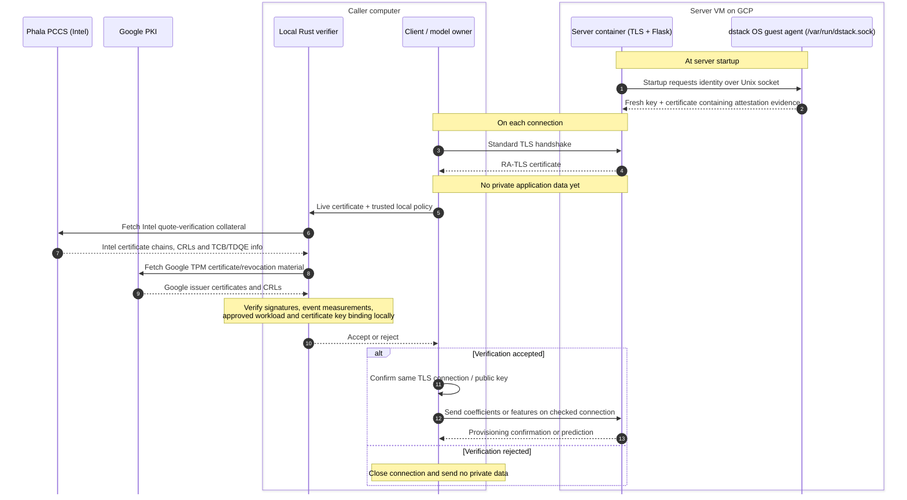
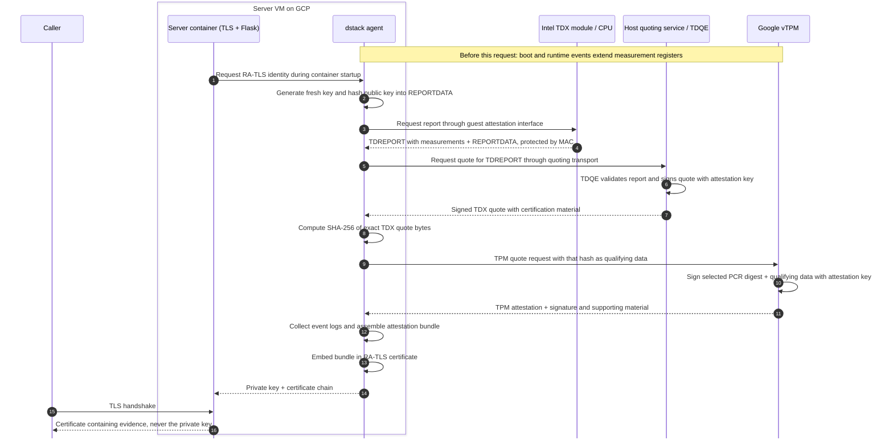

# Authenticate a TDX server with RA-TLS

In [module 3](../3_Deploy_TDX/README.md), the callers trusted a pre-generated server certificate. Now the model owner and prediction client will **verify the running deployment before sending private data**.

The server obtains a fresh TLS key inside the TDX guest. Its certificate carries attestation evidence describing the deployment and binding that evidence to the public key. Each caller verifies the evidence locally before using the connection. This is **RA-TLS: Remote Attestation TLS**. The TLS protocol itself stays standard.

The prediction API and model-file hash check remain unchanged. You will build the verifier, publish the server image, deploy it, and repeat the same owner/client workflow. Use synthetic inputs and follow [cleanup](#cleanup) when finished; cloud resources incur charges.

## Parties and components

| Party                 | What runs there                                                                                                                                                             |
| --------------------- | --------------------------------------------------------------------------------------------------------------------------------------------------------------------------- |
| **Server**            | A GCP TDX VM running dstack OS. Its guest agent supplies the TLS identity. Inside the container, Gunicorn/OpenSSL handle TLS and Flask handles model upload and prediction. |
| **Model owner**       | The upload script, its local Rust verifier, and its own trusted deployment policy.                                                                                          |
| **Prediction client** | The prediction script, its local Rust verifier, and its own trusted deployment policy.                                                                                      |

The guest agent and Flask are **components inside the server boundary**, not additional application parties. The Rust verifier runs on each caller's computer, not in the server. The operator publishes the image and prepares deployment files; both callers must approve their policy independently.

Neither caller receives the server's private key. The model file stays with the owner until verification succeeds. You can use one computer for the operator and both callers, but the server runs in the cloud VM.

## What each caller checks

An **attestation quote** is a signed record of measurements and security attributes. It contains hashes, not copies of the application binaries. An accompanying **event log** explains what contributed to the measured values.

A valid signature authenticates the evidence. The caller's **policy** decides whether that evidence describes the deployment it intends to trust:

| Question | What our verifier checks |
| -------- | ------------------------ |
| Is the platform evidence authentic and acceptable?                | Intel and Google signatures and certificate chains, revocation information, and platform security status. |
| Does the guest boot state match our approved release?             | The checked firmware measurement and Unified Kernel Image (UKI) boot executable hash.                     |
| Does the application configuration match our approved deployment? | The measured Compose hash, which commits to the pinned Docker image reference and launch settings.        |
| Is this evidence bound to the TLS key on this connection?         | The quote's public-key binding, together with TLS proof of possession of the corresponding private key.   |

The UKI bundles the kernel and initial filesystem used to boot the guest. Each caller's `policy.json` holds two approved hashes: the **UKI hash** for that boot executable and the **Compose hash** for the application configuration. Obtain them from the release and files you review, not by accepting whatever a remote server claims. Step 5 shows how.

### Intel and Google evidence

Our GCP verifier checks both evidence sources:

- **Intel TDX** supplies hardware-rooted evidence for platform security, application measurements, and the TLS-key binding.
- **Google vTPM**, a software-based virtual Trusted Platform Module, supplies signed measurements used for the firmware and UKI checks. It records measurements; it does not provide the VM's memory isolation.

The TPM quote includes the hash of the Intel quote, linking the evidence records. TDX also supports boot measurements; this division describes our verifier's dstack/GCP path. See [dstack's dual-attestation design](https://docs.phala.com/dstack-cloud/attestation-integration) for more.

### What collateral services supply

The caller also needs **collateral**: supporting certificates, revocation lists, and vendor security-reference information used to validate the quotes.

| Service | Material and trust root |
| ------- | ----------------------- |

| **Phala PCCS**          | A Provisioning Certificate Caching Service. It caches Intel-issued collateral, including Trusted Computing Base (TCB) security-version information and quoting-enclave identity. The verifier authenticates it under its trusted Intel root. |
| **Google PKI services** | Supply issuer certificates and revocation material for the vTPM certificate chain. The verifier uses its bundled Google root.                                                                                                                |

The verifier fetches Intel material from `https://pccs.phala.network` and Google issuer/revocation material from URLs referenced by the TPM certificate. **The local Rust verifier makes the acceptance decision.** Phala does not sign the Intel evidence, and neither service supplies the approved Compose or UKI hash. Neither needs the model weights or prediction features. For details, see [Intel collateral](#reference-e--intel-verification-collateral).

## Follow one connection

The server requests its certificate at container startup. Each caller then:

1. Opens TLS and receives the server's certificate, **without sending an HTTP request**.
2. Passes that certificate and its trusted policy to the local Rust verifier.
3. Sends its original request over the **same connection** only after all checks pass. Otherwise it closes the connection.



The two lifelines inside each box are components of that party. The guest agent provides the server identity; the local verifier authenticates it for the caller. The certificate arrives through TLS, not through a separate HTTP attestation request.

Our adapter completes TLS provisionally, then checks attestation before sending application data. It replaces ordinary CA/hostname authentication with those checks. Its provisional `CERT_NONE` settings are unsafe in an ordinary web client and must not be reused without the complete verification gate.

Each script invocation opens and verifies a connection, sends one request, and closes it. It does **not** create a new server key or quote for every request. A longer-running client could reuse the same authenticated TLS connection, but must authenticate a new connection after reconnecting.

## Prerequisites

Keep the Docker, uv, Google Cloud CLI, and platform-specific disk tools from module 3. You also need [Rust](https://rust-lang.org/tools/install/) to build the local verifier. Caller computers do not need TDX hardware.

This module contains its own server, client, and model-owner projects. Do not copy module 2's key or certificate into them. The guest agent will supply the server identity.

Run commands from this module's directory unless a step explicitly says `app/`:

```bash
# Enter module 4; the relative paths below start here.
cd /path/to/assignment-3/4_Remote_Attestation
```

Keep the operator's deployment variables in the same terminal. In a new terminal, restore the recorded identifiers rather than generating a new suffix. Each caller needs its own reviewed verifier executable and policy.

## Step 1 — Build the local verifier

Choose only your platform's build prerequisites:

**macOS:** install the Xcode command-line tools if absent; Homebrew supplies CMake and the command-line tools used below.

```bash
# Install Apple's compiler tools if this Mac does not already have them.
xcode-select --install  # Only if the tools are not already installed.
# Install build tools, OpenSSL, JSON tools, and GCP disk-packaging utilities.
brew install cmake openssl@3 jq gnu-tar coreutils mtools dosfstools gptfdisk
```

**Ubuntu/Debian Linux:**

```bash
# Refresh Ubuntu/Debian's package index before installing prerequisites.
sudo apt-get update
# Install the compiler, OpenSSL, JSON tools, and disk-packaging utilities.
sudo apt-get install -y build-essential cmake pkg-config openssl jq python3 curl tar mtools dosfstools gdisk coreutils
```

**Both platforms**, from `assignment-3/4_Remote_Attestation`:

```bash
# Confirm the Rust compiler is installed and show its version.
rustc --version
# Confirm Cargo, Rust's build and dependency manager, is available.
cargo --version
# Build an optimized verifier for this computer using the checked-in lockfile.
cargo build --manifest-path verifier/Cargo.toml --locked --release -p sec304-tdx-verifier
# Run the verifier's parser, certificate, and rejection tests with locked dependencies.
cargo test --manifest-path verifier/Cargo.toml --locked -p sec304-tdx-verifier
```

**Expected result:** the build succeeds, the tests pass, and `verifier/target/release/sec304-tdx-verifier` exists. This executable runs on the caller's computer—not inside the server container. Build it for each caller's OS, or distribute a reviewed binary for that OS; a macOS executable cannot run on Linux.

## Step 2 — Inspect the server and test locally

Inspect [server/tls_identity.py](server/tls_identity.py). It sends an HTTP/JSON request to `/GetTlsKey` on `/var/run/dstack.sock`, asking for a fresh private key and an attestation-bearing certificate.

That socket belongs to the **dstack guest agent**, a service provided by dstack OS outside the container but inside the TDX VM. [The Compose template](docker-compose.yaml.example) mounts it into the container. The callers never contact this socket.

The startup code saves the returned files under `/run/sec304-tls`. [start.sh](server/start.sh) runs identity setup before Gunicorn; [gunicorn_attested.py](server/gunicorn_attested.py) uses the files for HTTPS. Inspect the [Dockerfile](server/Dockerfile) to see which code enters the image. A failed identity request stops startup.

On your computer, run the local tests and build:

```bash
# Run local identity/transport tests in the server project's Python environment.
uv run --project server python -m unittest discover -s tests -v
# Build the Intel/Linux server image locally from server/; do not publish it.
docker build --platform linux/amd64 -t sec304-attested-local server
# Start a disposable container with volatile key storage and host port 18043.
# Without the guest socket, identity setup must fail before HTTPS starts.
docker run --rm --name sec304-attested-local \
  --tmpfs /run/sec304-tls:mode=0700 -p 18043:8000 sec304-attested-local
```

**Expected:** the Python tests and image build pass. On a normal laptop, the container then exits with a missing `/var/run/dstack.sock` error. That is intentional: real identity issuance requires the dstack guest. The `--rm` container disappears after exit; the local image remains. Do not add a fallback certificate to make this test pass.

## Step 3 — Publish the server image

The image contains the server and its startup code. The TLS identity is requested from dstack at runtime; no certificate or private key is copied into the image.

```bash
# Choose your own Docker Hub namespace and repository for this release.
export IMAGE_REPO='docker.io/YOUR_DOCKERHUB_USERNAME/sec304-house-price'
# Authenticate to Docker Hub so the following build can publish the image.
docker login docker.io
# Build for linux/amd64, push the tagged image, and save its published digest metadata.
docker buildx build --platform linux/amd64 \
  --tag "${IMAGE_REPO}:tdx-attested" --push \
  --metadata-file image-build.json server
# Read the published manifest/index digest from Buildx's metadata file.
export IMAGE_DIGEST="$(jq -r '."containerimage.digest"' image-build.json)"
# Combine the repository and digest into the immutable reference used by Compose.
export APP_IMAGE="$IMAGE_REPO@$IMAGE_DIGEST"
# Print the image reference to retain and paste into the workload configuration.
printf '%s\n' "$APP_IMAGE"
# Inspect the published registry artifact; this does not verify a running VM.
docker buildx imagetools inspect "$APP_IMAGE"
```

**Expected result:** `$APP_IMAGE` is a `repository@sha256:…` reference, and `imagetools inspect` resolves it. Save this reference for the Compose file in the next step. A tag can move; the digest identifies the published image manifest and the layers it references. Review the image/source before approving it. Updating the application requires a new published digest and a reviewed policy.

## Step 4 — Configure a fresh GCP deployment

Use the [official quickstart installation](https://docs.phala.com/dstack-cloud/get-started) from module 3 for `dstack-cloud`, and keep the pinned guest release below. On the **operator's computer**, authenticate and choose names for a new deployment. Replace only the project ID:

```bash
# Sign in as the deployment operator to manage resources in Google Cloud.
gcloud auth login
# Set your billing-enabled GCP project ID; replace this placeholder.
export PROJECT='YOUR_GCP_PROJECT_ID'
# Select the tutorial's Singapore zone for the TDX VM.
export ZONE='asia-southeast1-a'
# Generate a short resource-name suffix once for this new deployment.
export SUFFIX="$(openssl rand -hex 3 | cut -c 1-5)"
# Name this deployment's VM using that suffix.
export INSTANCE="sec304-tdx-ra-${SUFFIX}"
# Name its dedicated disk-archive upload bucket; the name must be globally unique.
export BUCKET="gs://sec304-dstack-ra-${SUFFIX}"
# Set gcloud's active project to the project selected above.
gcloud config set project "$PROJECT"
# Enable the Compute Engine API needed to create VM and disk-image resources.
gcloud services enable compute.googleapis.com --project "$PROJECT"
# Create a private regional upload bucket with uniform access control.
gcloud storage buckets create "$BUCKET" --project "$PROJECT" \
  --location=asia-southeast1 --uniform-bucket-level-access --public-access-prevention
# Print non-secret identifiers to retain for configuration, resuming, and cleanup.
printf 'PROJECT=%s\nINSTANCE=%s\nBUCKET=%s\n' "$PROJECT" "$INSTANCE" "$BUCKET"
```

Record the printed names for resuming and cleanup; do not regenerate them for the same deployment. The bucket stores disk-import archives, not model weights. If its globally unique name is taken, choose another bucket name before creating it.

The guest supplies its TLS identity locally, so this module needs **no TLS secret in Secret Manager, no secret-retrieval hook, and no IAP tunnel**.

In `dstack-cloud config-edit`, set the global project, zone, and bucket to the recorded values and keep `image_search_paths: ["~/.dstack/images"]`:

```bash
# Edit global CLI defaults, including this deployment's project, zone, and bucket.
dstack-cloud config-edit
```

```bash
# Download and unpack the complete GCP guest boot disk and UKI hash reference.
# This archive supplies disk.raw (including the root filesystem) and auth_hash.txt.
dstack-cloud pull https://github.com/Phala-Network/meta-dstack-cloud/releases/download/v0.6.0-test/dstack-cloud-0.6.0-uki.tar.gz
# Point to the downloaded release directory configured earlier.
export OS_IMAGE_DIR="$HOME/.dstack/images/dstack-cloud-0.6.0"
# Confirm the GCP raw boot disk and UKI hash reference exist and inspect their sizes.
ls -lh "$OS_IMAGE_DIR/disk.raw" "$OS_IMAGE_DIR/auth_hash.txt"
# Create local app/ configuration for a C3 TDX VM using TPM storage-key mode.
# Disable gateway ingress; this command does not create the cloud VM.
dstack-cloud new app --os-image dstack-cloud-0.6.0 \
  --instance-name "$INSTANCE" --project "$PROJECT" --zone "$ZONE" \
  --machine-type c3-standard-4 --key-provider tpm --no-gateway-enabled
# Copy the cloud workload template into app/ before selecting your image digest.
cp docker-compose.yaml.example app/docker-compose.yaml
```

Open `app/docker-compose.yaml` and replace its entire `image` placeholder with the approved `$APP_IMAGE`. Inspect the socket mount and volatile key directory. In `app/app.json`, check the generated GCP fields and leave default boot/data image names.

At the top level of `app/app.json`, add `"env_file": ".no-env"` or update the existing field. Keep it alongside `key_provider`, outside `gcp_config`, and **do not create `.no-env`**. This avoids an accidental `.env` file, which the CLI otherwise checks by default and which is incompatible with TPM mode.

As in module 3, `c3-standard-4` selects the TDX-compatible machine, `tpm` selects dstack's disk-key handling, and disabling the gateway lets us connect directly to the VM. Keep the default diagnostic flags enabled for the dashboard. The generated `prelaunch.sh` remains its empty template; [tls_identity.py](server/tls_identity.py) obtains the identity when the container starts.

## Step 5 — Approve the policy and deploy

### Review the launch configuration

From this module's directory, prepare the same workload document introduced in module 3:

```bash
# Enter the generated deployment directory where dstack-cloud reads app.json.
cd app
# Generate local shared configuration files for review; do not create a VM.
dstack-cloud prepare
# Display the generated workload document without changing its original bytes.
jq . shared/app-compose.json
# Return to the module root for policy creation and caller commands.
cd ..
```

### Create the caller policy

Create `policy.json` in this module's root directory with exactly these fields:

```json
{
  "compose_hash": "PASTE_APPROVED_APP_COMPOSE_SHA256",
  "uki_authenticode_sha256": "PASTE_APPROVED_RELEASE_AUTH_HASH"
}
```

Print the values to paste using the commands for your platform:

**macOS:**

```bash
# Compute SHA-256 over the exact generated workload bytes for compose_hash.
shasum -a 256 app/shared/app-compose.json
# Print the release's UKI Authenticode hash for uki_authenticode_sha256.
cat "$OS_IMAGE_DIR/auth_hash.txt"
```

**Linux:**

```bash
# Compute SHA-256 over the exact generated workload bytes for compose_hash.
sha256sum app/shared/app-compose.json
# Print the release's UKI Authenticode hash for uki_authenticode_sha256.
cat "$OS_IMAGE_DIR/auth_hash.txt"
```

**Expected result:** `policy.json` contains two reviewed, 64-character hexadecimal hashes. Distribute this policy to both callers through a trusted channel.

The Compose value approves the exact generated launch document, including the pinned Docker reference. Do not reformat that document before hashing it. The UKI is the **Unified Kernel Image**, the boot executable containing the kernel and initial filesystem. Its reference is the release's `auth_hash.txt` value, **not** a plain SHA-256 of `disk.raw`.

Both callers must review and trust these references independently of the server. The server still enforces the model file's existing hash; the prediction client does not check the weights separately.

### Deploy the approved configuration

Deploy from `app/` using **only your platform's block**. Review billing/resource names before running it.

**macOS:**

```bash
# Enter the generated deployment directory where dstack-cloud reads app.json.
cd app
# Select Homebrew GNU tar/coreutils and expose the required disk tools in this shell.
export PATH="$(brew --prefix gnu-tar)/libexec/gnubin:$(brew --prefix coreutils)/libexec/gnubin:$(brew --prefix)/bin:$(brew --prefix)/sbin:$PATH"
# Clear cached executable locations so the shell uses the updated PATH.
hash -r
# Show which tar executable this shell and the deployment command will use.
command -v tar
# Check the archive tool is GNU tar before running deployment.
tar --version  # Must say GNU tar, not bsdtar. Stop and fix PATH otherwise.
```

After checking the output:

```bash
# Use GCP-compatible old-GNU sparse archives when deploying the disks and TDX VM.
# This creates billable cloud resources and regenerates the shared configuration.
TAR_OPTIONS='--format=oldgnu --sparse' dstack-cloud deploy
```

**Linux:**

```bash
# Enter the generated deployment directory where dstack-cloud reads app.json.
cd app
# Show which tar executable this shell and the deployment command will use.
command -v tar
# Check the archive tool is GNU tar before running deployment.
tar --version  # Must say GNU tar. Stop and select GNU tar otherwise.
```

After checking the output:

```bash
# Use GCP-compatible old-GNU sparse archives when deploying the disks and TDX VM.
# This creates billable cloud resources and regenerates the shared configuration.
TAR_OPTIONS='--format=oldgnu --sparse' dstack-cloud deploy
```

### Check the deployment

From `app/`, check that the VM is running:

```bash
# Check the operational status of this deployment.
dstack-cloud status
```

If boot fails, use `dstack-cloud logs --follow` for the VM's serial console; Ctrl-C stops viewing without stopping the VM. The dashboard in step 6 shows the application container's logs separately.

Deployment regenerates `app-compose.json`. If its inputs changed after approval, stop and review the new hash rather than automatically replacing the caller's policy.

## Step 6 — Verify the server and use the application

### Allow the caller to connect

First find the public IPv4 address of the computer that will run the client or model owner. Run this on the **caller's computer**, on macOS or Linux:

```bash
# Ask ipify for the public IPv4 address used by this computer's outbound connection.
# This is the address the cloud firewall needs, rather than a local Wi-Fi address.
CALLER_IP=$(curl -4 --fail --silent --show-error https://api.ipify.org)
# Record the printed address for the firewall rule below.
printf 'Caller public IPv4: %s\n' "$CALLER_IP"
```

Expect your public IPv4 address, not a local Wi-Fi address. Stop if the command fails or prints nothing. Keep the same network/VPN when connecting; a change may require updating the firewall rule. [ipify](https://www.ipify.org/) supplies this lookup.

On the **operator's computer**, from `app/`, allow only that caller's public source IP, not `0.0.0.0/0`. If it is the same computer and terminal, `CALLER_IP` is already set. Otherwise, set `CALLER_IP` to the address printed on the caller's computer before running these commands:

```bash
# Allow HTTPS on port 8000 only from the caller's public IP (/32 = one IPv4 address).
dstack-cloud fw allow 8000 --source "${CALLER_IP}/32"
# Print the selected VM's external IP for the callers' SERVER_URL.
gcloud compute instances describe "$INSTANCE" --project "$PROJECT" --zone "$ZONE" \
  --format='value(networkInterfaces[0].accessConfigs[0].natIP)'
```

If the callers use different public IPs, allow both approved ranges and inspect the resulting rule. Repeating `fw allow` may leave an existing rule unchanged; edit its source ranges in Console rather than assuming it appends them. No IAP tunnel or IAP proxy-range rule is used here.

### Inspect the dstack dashboard

Before running the callers, open the **dstack guest dashboard**. This is a service provided by the guest OS, separate from the prediction server. From `app/`, temporarily allow access only from your computer's public IP:

```bash
# Allow the guest dashboard on port 8090 only from your public IPv4 address.
# Use the CALLER_IP obtained above; do not open this diagnostic port to everyone.
dstack-cloud fw allow 8090 --source "${CALLER_IP}/32"
# Read the current VM address rather than reusing an address from an older deployment.
DASHBOARD_IP=$(gcloud compute instances describe "$INSTANCE" --project "$PROJECT" --zone "$ZONE" \
  --format='value(networkInterfaces[0].accessConfigs[0].natIP)')
# Open this printed HTTP URL in your browser; it is not the application HTTPS endpoint.
printf 'dstack dashboard: http://%s:8090/\n' "$DASHBOARD_IP"
```

Under **Containers → View logs**, open the server's logs. Expect `TLS identity received successfully via /GetTlsKey`, followed by Gunicorn startup. A failure here can leave the caller with `Connection refused` before it reaches any attestation check.

Next, inspect **TCB Info**. **TCB** means **Trusted Computing Base**, the hardware and software on which security depends. Look at the guest and application measurements and relate them to the policy you approved.

The dashboard is a readable view of related guest state. The caller instead verifies the quotes and event logs embedded in the **actual TLS certificate**, including its key binding. The HTTP dashboard itself is not authenticated by our RA-TLS verifier and does not prove attestation passed. Do not enter secrets there. Close access when finished:

```bash
# Remove the temporary dashboard rule; leave application port 8000 unchanged.
dstack-cloud fw remove 8090
```

### Run both callers

On the **caller computer**, open this module's root directory. If using the operator's same terminal, return from `app/` with `cd ..` first. Inspect [client/client_attested.py](client/client_attested.py) and [model_owner/model_owner_attested.py](model_owner/model_owner_attested.py), then [attested_transport.py](client/attested_transport.py).

The entry points reuse the original application requests. The transport receives the TLS certificate, invokes the local verifier, and waits for acceptance before sending the request. The owner has the same transport in its own project.

Set the current VM address and your **local** verifier/policy paths:

```bash
# Select the deployed HTTPS endpoint; replace the IP placeholder.
export SERVER_URL='https://PASTE_VM_EXTERNAL_IP:8000'
# Tell this caller where to find its locally built Rust verifier executable.
export TDX_VERIFIER="$(pwd)/verifier/target/release/sec304-tdx-verifier"
# Tell this caller where to read its independently approved local policy.
export ATTESTATION_POLICY="$(pwd)/policy.json"
# Authenticate the deployment, then expect HTTP 503 before model provisioning.
uv run --project client python client/client_attested.py --url "$SERVER_URL"
# Independently verify as the model owner, then upload the approved file.
uv run --project model_owner python model_owner/model_owner_attested.py --url "$SERVER_URL"
# Independently verify as the client, then send features and print the prediction.
uv run --project client python client/client_attested.py --url "$SERVER_URL" \
  --area-m2 120 --bedrooms 3 --age-years 10
```

**Expected results, in order:**

1. The first client verifies the server, then receives HTTP 503 because no model is loaded.
2. The owner verifies the server and receives confirmation that its model was provisioned.
3. The client verifies the server and receives `prediction_baht: 5750000`.

Always pass `--url "$SERVER_URL"` for this cloud deployment. Without it, the wrapper defaults to `https://localhost:18043`, not the VM. Recheck the external IP after replacing a VM.

On separate computers, each role needs its own environment, reviewed verifier, and independently approved policy. It does not need the other role's files. After a server restart, the fresh TLS identity changes and the in-memory model is empty; the owner must verify and provision again.

### Inspect the certificate and verification output

**Complete this inspection before finishing the module.** Repeat the requests with `--debug` to print progress, the certificate, and its embedded evidence. Verification runs on every request even without this flag. The client should predict successfully; a repeated owner upload verifies first, then returns HTTP 409 because the model is already loaded.

```bash
# Run the client: verify the server before requesting a prediction; print debug progress.
uv run --project client python client/client_attested.py --url "$SERVER_URL" --debug
# Run the owner: verify the server before uploading its model; print debug progress.
uv run --project model_owner python model_owner/model_owner_attested.py --url "$SERVER_URL" --debug
```

The trace prints the public certificate in PEM form and the extracted evidence as **UNVERIFIED**. Only `Verification accepted` means the checks passed. Rust's progress appears when the verifier finishes; all debug output goes to standard error, leaving the result on standard output.

These are public evidence fields, not private keys or uploaded inputs. Saved logs may still reveal workload identifiers.

| Received evidence field                    | What you are looking at                                                                                              |
| ------------------------------------------ | -------------------------------------------------------------------------------------------------------------------- |
| `tdx_quote_hex`                            | Exact Intel quote bytes extracted from the certificate, displayed as hexadecimal.                                    |
| `tdx_event_log`                            | Supporting TDX measurement events.                                                                                   |
| `tpm_attestation_hex`, `tpm_signature_hex` | Google's TPM attestation message and its signature.                                                                  |
| `tpm_pcr_values`, `tpm_event_log`          | Reported PCR values and boot events checked against the TPM attestation.                                             |
| `runtime_events`                           | dstack event names/payloads used to recompute RTMR3 and PCR14. Payloads are encoded bytes, not application binaries. |
| `report_data` | The Intel quote's binding to the certificate public key, checked by the verifier. |

After verification succeeds, the trace prints the verified claims. For example (hashes abbreviated here; your console prints them in full):

```json
{
  "is_valid": true,
  "tee_variant": "dstack-gcp-tdx",
  "tcb_status": "UpToDate",
  "compose_hash": "7d99…",
  "uki_authenticode_sha256": "9f03…",
  "report_data": "82c1…",
  "certificate_sha256": "84c5…"
}
```

| Field                     | Meaning                                                                                                                                                             |
| ------------------------- | ------------------------------------------------------------------------------------------------------------------------------------------------------------------- |
| `is_valid`                | All checks required by this verifier passed. This is not a claim that the application is bug-free.                                                                  |
| `tee_variant`             | The evidence is for the supported GCP Intel TDX deployment.                                                                                                         |
| `tcb_status`              | Intel's verification result for the platform security versions. Our policy requires `UpToDate`.                                                                     |
| `compose_hash`            | The measured application configuration hash, which matched your local policy. It covers the pinned image reference, not just the Python source.                     |
| `uki_authenticode_sha256` | The approved boot executable hash that matched the UKI measurement in the Google TPM evidence.                                                                      |
| `report_data` | The Intel quote's binding to the certificate public key, checked by the verifier. |
| `certificate_sha256`      | Hash of the exact TLS leaf certificate verified by Rust. Python checks that it matches the certificate on its live connection. This is not the Docker image digest. |

The acceptance message means it is safe to proceed **under this module's stated policy and trust assumptions**. An application error afterward—for example, HTTP 503 because the model is not provisioned—does not mean attestation failed. If verification fails, the caller prints the rejection reason even without `--debug` and sends no application request.

In your output, locate the PEM certificate, the extracted Intel and Google evidence, and the accepted claims. Compare `compose_hash` and `uki_authenticode_sha256` with your local `policy.json`. Follow the public-key binding check in the trace, then find `Verification accepted` before the application request. Use the tables above to connect each check to the evidence it uses; printing a certificate alone is not verification.

## Troubleshooting

Rerun the caller with `--debug` and find the first rejection reason. Do not disable verification or replace the trusted policy with values taken from a rejected server.

| Symptom                                      | What to inspect                                                                                                                          |
| -------------------------------------------- | ---------------------------------------------------------------------------------------------------------------------------------------- |
| Cannot connect to the HTTPS endpoint         | VM status, external IP, port 8000 and the firewall's caller-IP range.                                                                    |
| Server exits before HTTPS starts             | Dashboard **Containers → View logs**, the guest-agent socket mount, and the `/GetTlsKey` response in `tls_identity.py`.                  |
| Missing or unsupported attestation extension | Whether you reached the intended RA-TLS server and used the pinned guest/evidence format.                                                |
| Compose or UKI mismatch                      | The reviewed policy, pinned image reference and guest release. A changed deployment needs a deliberate review, not automatic acceptance. |
| Collateral retrieval or validity failure     | Caller internet access and clock, followed by the verifier's diagnostic.                                                                 |
| Certificate expired                          | Renew the identity by restarting the server, then have the owner provision its model again.                                              |
| Verification accepted, then HTTP 503         | The application has no model yet. Run the model owner; this is not an attestation failure.                                               |

## Security boundaries

The quote is created when dstack issues the certificate, not for every caller. TLS proves current possession of that certificate's key, but it does not prove the quote was just generated. We request a one-day certificate and check its validity, but certificate dates are not a hardware-authenticated quote timestamp. This tutorial does not provide challenge-based evidence freshness. Restart to renew the identity before expiry; there is no automatic renewal in this module.

Attestation authenticates measurements under stated Intel/Google and guest-OS assumptions; it does not prove the application has no bugs, authorize every uploader, or prevent denial of service. The guest-agent socket is a powerful capability and the approved Compose must include only reviewed workloads. This is a tutorial implementation, not a production security certification.

## Optional — Update an existing deployment

Editing local source does not update the published image or running container. To update a disposable tutorial deployment:

1. Rebuild and publish using step 3, then replace the pinned `image` in `app/docker-compose.yaml`.
2. Repeat preparation and approve the new Compose hash in both callers' policies. Keep the UKI hash if the guest release is unchanged.
3. Review the selected instance, then repeat the platform-specific deployment command with `--delete`. **This deletes and recreates the VM, clears the uploaded model, and may change its external IP.**
4. Recheck the address and firewall, then have the owner verify and provision again.

An application-only update needs neither a new OS download nor manual TLS-key generation.

## Cleanup

Close local containers/connections. In the generated `app/` directory, review its state and identifiers, then:

```bash
# Remove this deployment's application-port firewall rule; run from its app/ directory.
dstack-cloud fw remove 8000
# Delete this deployment's VM and shared image; follow the remaining cleanup checks.
dstack-cloud remove
```

If you left the diagnostic dashboard rule open, remove it with `dstack-cloud fw remove 8090` from `app/` as well. Removal may take time. Wait for completion and confirm cloud state using the **VM, firewall, disk, image, and bucket checks** in [module 3's cleanup verification section](../3_Deploy_TDX/README.md#verify-cleanup-against-google-cloud), with this module's original identifiers. Skip its `TLS_SECRET`/`VM_SA_EMAIL` checks: this module creates no TLS secret or dedicated secret-access account. Delete this deployment's dedicated upload bucket/archives and leftover disks/images after reviewing ownership. Keep current reusable OS/data templates only while actively redeploying; delete them at final cleanup. Storage soft-delete retention may still incur charges. Keep local source and verifier files, but never publish generated private keys.

## Reference A — How reports become signed quotes

There are three different objects here: a **TDREPORT** is a hardware-authenticated local report, a **TDX quote** is remotely verifiable signed evidence derived from that report, and the **attestation bundle** is the package our server returns containing quotes and supporting event logs. The server does not sign the TDX quote with its TLS key.



This diagram separates responsibilities, not the individual Linux driver calls. The guest quote API hides the report-generation and host quoting transport. The **TD Quoting Enclave (TDQE)** runs outside the application VM, protected as an Intel SGX enclave. It validates the local report before signing the quote with its attestation key. Certification material binds that key to the platform through the PCK certification chain rooted in Intel—not through the Flask certificate or Phala. See [Intel's attestation architecture](https://cc-enabling.trustedservices.intel.com/intel-tdx-enabling-guide/02/infrastructure_setup/) and [TDX module specification](https://cdrdv2-public.intel.com/853286/intel-tdx-module-base-spec-348549006.pdf).

In the public-key binding below, `TLS_SPKI_DER` is the full DER-encoded SubjectPublicKeyInfo from the TLS certificate. The hash covers those exact bytes together with the `ratls-cert:` prefix.

| Producer               | Produces                                             | What it binds or authenticates                                                                                                                                         |
| ---------------------- | ---------------------------------------------------- | ---------------------------------------------------------------------------------------------------------------------------------------------------------------------- |
| dstack guest agent     | `REPORTDATA = SHA512(b"ratls-cert:" + TLS_SPKI_DER)` | The new certificate's public key. This hash alone is not evidence.                                                                                                     |
| Intel TDX module / CPU | MAC-protected TDREPORT                               | TDX measurements, attributes and supplied REPORTDATA. A local report, not yet a remotely verifiable signature.                                                         |
| TD Quoting Enclave     | Signed TDX quote                                     | The report's attested contents, using the QE attestation key and Intel-rooted certification.                                                                           |
| Google vTPM            | Signed TPM quote                                     | Selected PCR values and `SHA256(TDX quote)` in qualifying data, binding the two quotes together. Its certificate chain is rooted in Google's TPM trust infrastructure. |
| dstack agent           | Encoded attestation bundle                           | Packages the quotes, event logs and configuration. Packaging itself adds no signature or trust.                                                                        |

The logs are not signed independently: their integrity is checked by recomputing the measurement chains and comparing them with the registers authenticated by the quotes. The bundle contains hashes and event payloads, not a copy of every application binary.


## Reference B — Source provenance and adaptations

This module contains an **adapted GCP-only subset**, not a verbatim copy of the entire upstream `dstack-verifier` CLI. The source baseline is [Dstack-TEE/dstack](https://github.com/Dstack-TEE/dstack) at commit **`f5c2e6f4a47874d85465003d8abf65be613b9b2e`**. The copied source and pinned dependencies make the verification implementation inspectable.

The adapted verification logic comes from:

- [`dstack/dstack-attest/src/attestation.rs`](https://github.com/Dstack-TEE/dstack/blob/f5c2e6f4a47874d85465003d8abf65be613b9b2e/dstack/dstack-attest/src/attestation.rs): legacy evidence types, `verify_tdx`, `verify_tpm`, and TDX attribute checks.
- [`dstack/verifier/src/verification.rs`](https://github.com/Dstack-TEE/dstack/blob/f5c2e6f4a47874d85465003d8abf65be613b9b2e/dstack/verifier/src/verification.rs): GCP OVMF PCR0 and PCR2 UKI verification.
- `verifier/vendor/` copies the upstream `cc-eventlog`, `dstack-types`, `tpm-types`, `tpm-qvl`, `size-parser`, and `crates/pki-fetch` Rust sources/manifests, plus Google's public production TPM root and the event-log sample/snapshot fixtures. Existing copyright/SPDX notices and the Apache/MIT license texts are retained under `verifier/LICENSES/`.

The verifier's supported scope is:

1. Accept **GCP Intel TDX only**. Preserve its SCALE V0 variant index `1`. Reject other platforms, unsupported versions, and trailing bytes. Parsing alone adds no trust.
2. Do not include `sev-snp-attest`, `sev-snp-qvl`, AWS NSM verification, guest quote-generation crates, the upstream HTTP verifier service, or its full certificate verifier. Our small certificate extractor follows upstream `ra-tls/src/attestation.rs` and `ra-tls/src/oids.rs` for the GCP extension. Shared upstream types retain some cross-platform enums/schema for compatibility; those are not enabled verification paths.
3. Keep **Google vTPM verification**. GCP's evidence combines Intel TDX with Google vTPM; removing TPM would remove part of the boot verification, not merely remove another hardware platform.
4. Use a trusted local **UKI Authenticode SHA-256** from the release's `auth_hash.txt` directly, instead of full `CvmVerifier`'s aggregate OS-manifest identity and `vm_config.gcp_measurement` document. The pinned cloud CLI does not produce that document. This adapter therefore uses a narrower policy interface; it is not the full upstream verifier.
5. Require `UpToDate`, the exact approved Compose digest, and the certificate's attested TLS public key. Do not support custom trust roots or simulator acceptance.

Intel cryptographic verification remains in the pinned [`dcap-qvl` 0.5.3](https://github.com/Phala-Network/dcap-qvl) dependency. Its source is fetched by Cargo, not copied into this module; `Cargo.lock` records the resolved registry dependencies. Google certificate/signature/revocation/PCR verification remains in the copied `tpm-qvl`. We are not reimplementing those cryptographic primitives. This local adaptation still requires review and hardware regression testing; it is not claimed to inherit an upstream audit.


## Reference C — Exact verification checks

Start with [certificate.rs](verifier/src/certificate.rs) for certificate parsing, then follow [verification.rs](verifier/src/verification.rs) for the hardware and policy checks:

1. Fetch Intel collateral from the default Phala PCCS and verify the TDX quote under the production Intel trust root, including the QVL's collateral validity checks. Phala distributes collateral; it does not issue our acceptance verdict or replace Intel's root.
2. Reject SGX/non-TDX reports, debug TDs, unexpected SEAM/service-TD attributes, and any TCB status other than `UpToDate`.
3. Parse the actual TLS leaf certificate, require current certificate validity and exactly one dstack evidence extension (OID `1.3.6.1.4.1.62397.1.8`), and match signed `REPORTDATA` against `SHA512(b"ratls-cert:" || TLS_SPKI_DER)`. SPKI comes from that certificate, not a separate server claim.
4. Recompute ordered runtime-event extensions with SHA-384 and compare against signed TDX RTMR3. The event log contains names/payloads such as `compose-hash`, not a copy of the application binary.
5. Verify the Google vTPM quote under the bundled Google root, including certificate-chain/revocation checks and boot event-log replay. Require its qualifying data to equal `SHA256(the exact Intel quote)`.
6. Recompute those same runtime events with SHA-256 and compare against quoted TPM PCR14.
7. Check the pinned upstream GCP OVMF PCR0 value and the PCR2 UKI event against the independently approved release UKI hash. A UKI packages the boot kernel/initramfs/parameters; the guest OS and its measured boot/storage machinery remain part of the trusted computing base. This adapter does not independently compute expected values for every TDX RTMR0–2 register, nor audit every file in the Docker image.
8. Extract exactly one boot-time `compose-hash` before `system-ready` and compare it with the caller's approved configuration digest. That configuration includes the Docker image reference, so the pinned application image is covered through the configuration commitment.

Finally, the Python adapter checks that it still has the same TLS connection/public key and only then sends the original application request. If the original connection is no longer available, the adapter refuses to reconnect implicitly. A new connection must start verification again. The Gunicorn keep-alive setting allows time for local verification.

The verifier contacts PCCS and the Google certificate/CRL URLs discovered from the AK certificate's AIA/CRL extensions. It does not send your model coefficients or prediction features to either service. Keep the caller's clock correct. Network failure, malformed evidence, or an expired/unacceptable platform status must reject—not bypass verification. See [dstack GCP attestation architecture](https://docs.phala.com/dstack-cloud/attestation-integration) and inspect the copied `tpm-qvl/src/collateral.rs` and `crates/pki-fetch/src/lib.rs` for the actual retrieval logic.

## Reference D — Google boot measurements

This optional reference explains the Google evidence included alongside the Intel quote. The working verifier checks both; the main tutorial focuses on TDX and RA-TLS.

**Google TPM quote — the booted guest OS**

TPM measurements accumulate in **Platform Configuration Registers (PCRs)**. Like TDX's RTMRs, these registers hold hash chains, not binaries. The accompanying **event log** lists what contributed to each chain; the verifier recomputes it and compares the result with the authenticated register value.

| Measurement or field | What it measures or binds                                                                    |
| -------------------- | -------------------------------------------------------------------------------------------- |
| `PCR0`               | Google boot firmware.                                                                        |
| `PCR2`               | Boot executables, including the dstack UKI: the boot image containing the kernel and initrd. |
| `PCR14`              | The same dstack runtime events recorded in TDX RTMR3.                                        |
| `qualified_data`     | The hash of the Intel TDX quote, linking the two quotes.                                     |

The TPM signs a digest of the selected PCR values, together with the qualifying data. Supporting PCR values and event logs let the verifier check that digest and understand what was measured.

## Reference E — Intel verification collateral

The pinned `dcap-qvl` verifier uses the following material. The platform certificate chain is normally embedded in the quote; the remaining collateral is retrieved through PCCS and certificate distribution URLs.

| Material                                                    | What the caller uses it for                                                                                                                                                            |
| ----------------------------------------------------------- | -------------------------------------------------------------------------------------------------------------------------------------------------------------------------------------- |
| **PCK certificate and issuer chain**                        | Authenticate the platform's Provisioning Certification Key, which certifies the quoting key, under Intel's root.                                                                       |
| **PCK and root-CA certificate revocation lists (CRLs)**     | Check whether certificates in that chain have been revoked.                                                                                                                            |
| **TDX TCB Info**                                            | Compare reported platform/TDX security versions with Intel's published Trusted Computing Base (TCB) levels, statuses and advisories. It also contains TDX module identity information. |
| **TD Quoting Enclave (TDQE) Identity**                      | Check the identity and security version of the enclave that signs the quote.                                                                                                           |
| **TCB Info and TDQE Identity signatures and issuer chains** | Verify that these reference documents were signed by Intel, rather than trusting the server that delivered them.                                                                       |

The verifier also checks the applicable validity dates. Authentic material can still describe an outdated or revoked platform; our tutorial requires an acceptable `UpToDate` result. See [Intel's TDX attestation guide](https://cc-enabling.trustedservices.intel.com/intel-tdx-enabling-guide/02/infrastructure_setup/) and [Intel's collateral service API](https://api.portal.trustedservices.intel.com/content/documentation.html) for further details.

## Reference F — Application and TDX measurements

The Intel TDX quote contains measurement values—not the binaries themselves. The fields below describe the VM, its measured events and the TLS public key. The additional Google evidence is handled by the verifier as described in the dual-attestation note above.

**Intel TDX quote — the VM and its runtime**

| Report field | What it measures or binds                                                                                              |
| ------------ | ---------------------------------------------------------------------------------------------------------------------- |
| `MRTD`       | The initial VM contents measured when the trust domain is built.                                                       |
| `RTMR0–2`    | Boot measurements recorded by the firmware and boot software. The exact allocation depends on the boot implementation. |
| `RTMR3`      | dstack runtime events, including the application configuration's hash.                                                 |
| `REPORTDATA` | A hash of the certificate's TLS public key. TLS proves current possession of the corresponding private key.            |

The quote also contains platform/TDX security-version information and attributes, such as whether debug mode is enabled.

**Where does our server code fit?**

```text
Server code + Python + dependencies
        ↓ packaged into
Docker image, identified by its image digest
        ↓ referenced in
app-compose.json
        ↓ hashed and recorded as a runtime event
compose-hash
        ↓ included in the measurement chains
TDX RTMR3
```

So there is no separate `server.py` field in the report. We approve the application configuration, which pins the Docker image. We trust the approved dstack guest to launch that image.

An **event log** lists the inputs that contributed to a measurement chain. For the runtime events, the verifier recomputes that chain and compares it with the signed RTMR3 value. It then checks that the measured application configuration matches our policy.

The verifier combines the TDX application/key checks with the Google boot checks described above. Model coefficients and client features arrive later and are not boot measurements. For implementation details, see the optional [exact verification checks](#reference-c--exact-verification-checks).

## What you now have

Both callers authenticate the approved measured deployment and its TLS key before releasing their inputs. Standard TLS protects the connection, while locally verified attestation replaces the pre-distributed certificate trust from modules 2 and 3. The prediction API and approved-model-file restriction remain the same.

Keep the reviewed source, release references, verifier, and caller policies together. Changes to the guest or application configuration require deliberate review and a new approved policy.
